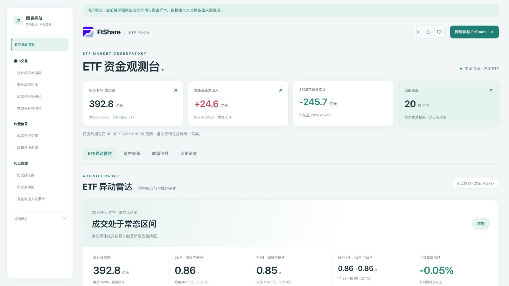
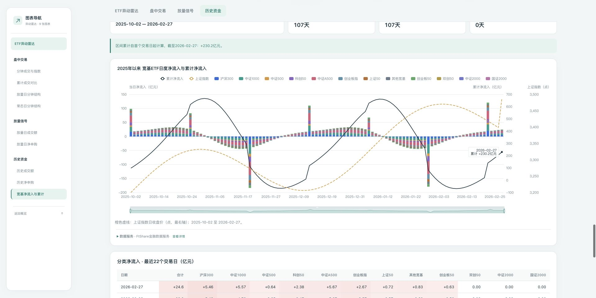
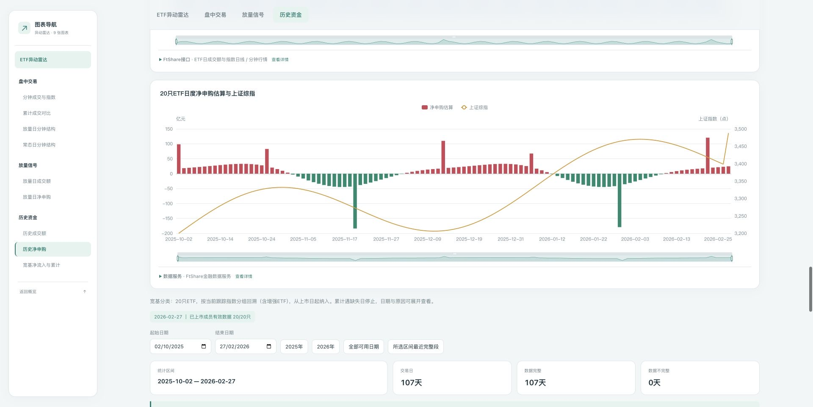
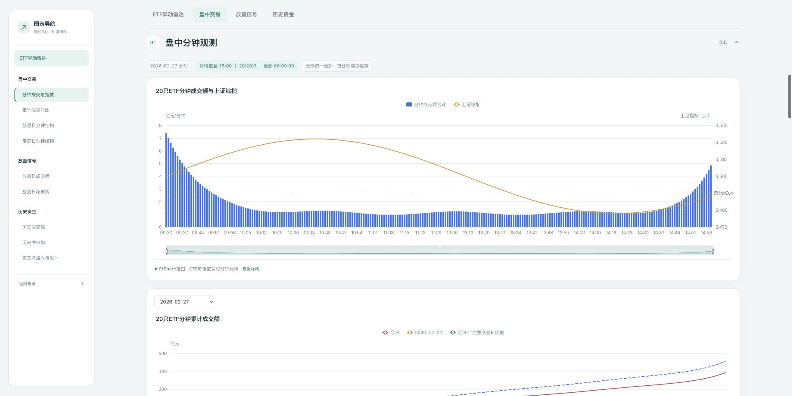
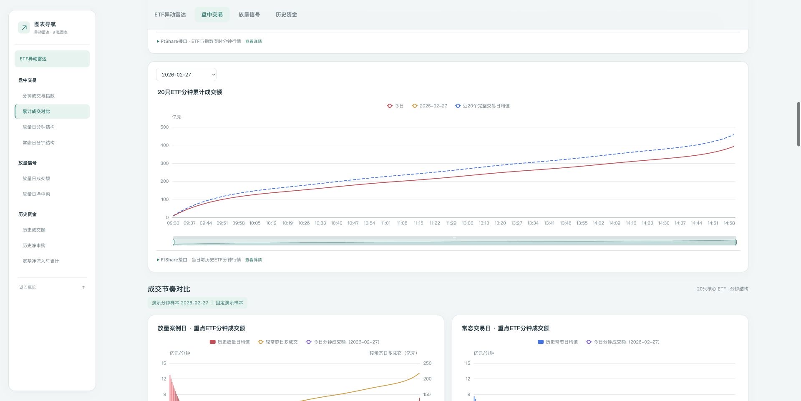
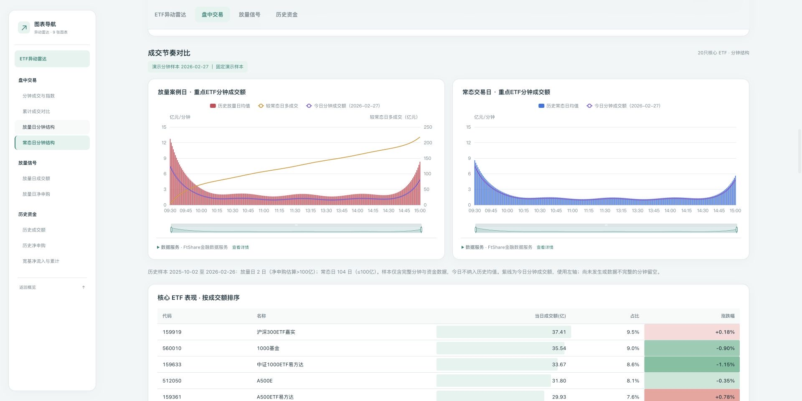
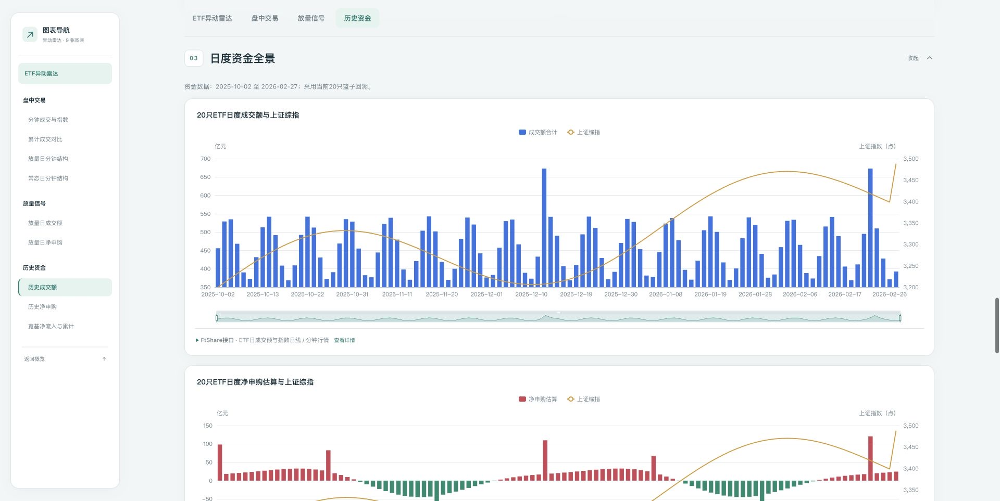

# FtShare · ETF 资金观测台

**发现成交异动，跟踪宽基资金，从盘中观察到盘后复盘。**

**数据服务：FtShare**

面向 A股 ETF 投资者与研究者，将成交雷达、盘中行情、历史对照和日度净申赎估算汇集在同一页面。

[在线体验](https://etf.jtxaionline.com/#radar) · [部署自己的看板](#部署自己的看板) · [了解 FtShare](https://ftai.chat/ftshare)

**v0.1.0 · ETF异动雷达 · 20／60日双基准 · 20只核心ETF · 12类宽基 · 9张分析图表**



## 用它观察市场

- **发现成交异动**：对照20日、60日历史同进度成交，观察累计放量与短时放量；支持阈值调整和时点回放。
- **比较盘中节奏**：将今日分钟成交与放量日、常态日对照，结合上证指数和核心ETF表现复盘。
- **跟踪宽基资金**：查看12类宽基ETF的日度净申赎估算与区间累计，按年份或自选日期比较。
- **持续查看市场**：行情自动刷新，多人共享同一份行情缓存。支持手机浏览、深浅主题和文字导航。

每张图均可查看数据来源与计算口径。[雷达规则](docs/radar-preview.md) · [资金计算](docs/data.md)

## 关键数据图

**宽基资金与区间累计** · 分类净申赎、区间累计与上证指数放在同一张图中。



**历史净申赎** · 按日期观察核心ETF的净申购、净赎回及大盘走势。



**分钟成交与指数** · 查看开盘、午后和尾盘的成交节奏。



**累计成交对比** · 对照今日、所选历史日与近20日均值，观察放量程度。



**放量日与常态日** · 并排比较历史分钟结构，叠加今日成交曲线。



**历史成交额** · 对照日度成交规模与上证指数，复盘交易活跃度。



## 部署自己的看板

1. [获取 FtShare API Key](https://ftai.chat/me/profile)。
2. 按 [部署指南](docs/deployment.md) 配置数据、后台采集与网页服务。

推荐云端方案：**Cloudflare Pages + 采集Worker + 共享缓存**。Key配置在采集端，网页与雷达读取共享数据；盘中每分钟采集，日度任务按北京时间08:00、12:30、18:00运行。[云端配置](docs/cloud-scheduled-update.md)

## 本地体验

需要 Node.js 24+。

```sh
npm ci
cp .env.example .env
npm run dev
```

打开 [http://127.0.0.1:8080](http://127.0.0.1:8080)，使用内置演示数据。在`.env`设置`ENABLE_RADAR=1`后重新运行，可体验异动雷达。

## FtShare 金融数据服务

本项目是 **FtShare** 的开源金融应用案例，由 ETF 行情、基金份额、净值和交易日历接口驱动。

FtShare 为 AI Agent、量化研究和金融应用提供数据服务，支持 [Python SDK](https://github.com/FTShare-Lab/FTShare-python-sdk)、[MCP](https://github.com/FTShare-Lab/FTShare-MCP) 和 [Skill](https://github.com/FTShare-Lab/FTShare-skill)，可用于构建自己的分析工具与金融应用。

[数据接口](https://market.ft.tech/gateway/doc/) · [数据与计算](docs/data.md) · [其他部署方式](docs/deployment.md) · [参与开发](CONTRIBUTING.md) · [更新日志](CHANGELOG.md)

[MIT 开源许可](LICENSE) · [第三方许可](THIRD_PARTY_NOTICES.md)
