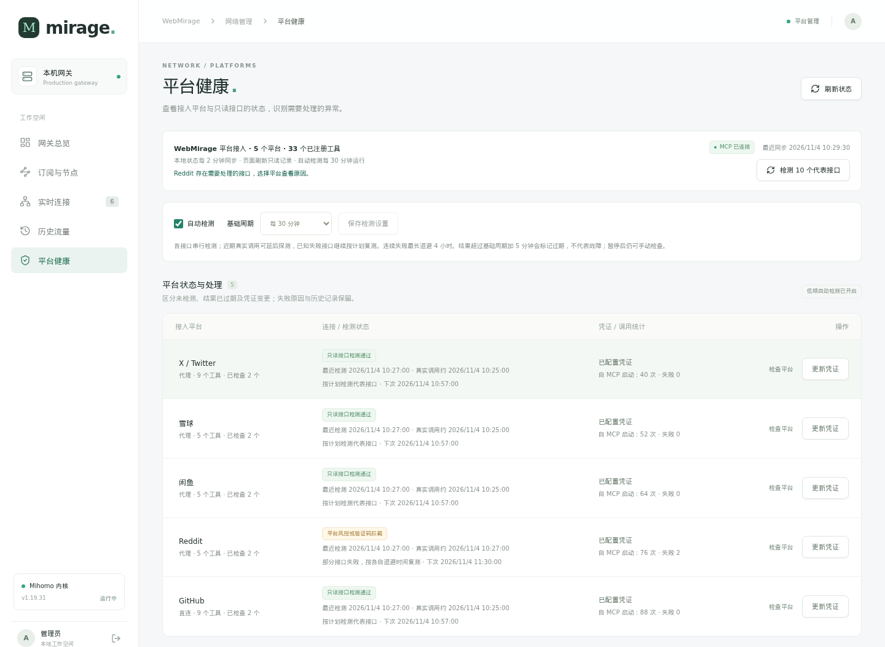

<h1 align="center">🌊 webmirage</h1>

<p align="center">
  <strong>统一查看接口状态、定位异常、维护凭证并复测确认</strong>
</p>

<p align="center">
   网蜃楼 — 平台接口健康与维护中心，集成服务器代理管理
</p>

<p align="center">
  <a href="LICENSE"></a>
  <a href="https://www.python.org/"></a>
  <a href="https://modelcontextprotocol.io/"></a>
</p>

<p align="center">
  <a href="#快速上手">快速开始</a> · <a href="#网关控制台--最新更新">网关与页面预览</a> · <a href="README_en.md">English</a> · <a href="#支持的平台">支持平台</a> · <a href="#设计理念">设计理念</a> · <a href="#闲鱼智能评分系统">闲鱼评分</a>
</p>

---

## 为什么需要 webmirage？

网站接口接入之后，还需要持续维护：今天能调用的接口，可能因为 Cookie 过期、平台限流、风控或代理节点故障而中断。对依赖这些接口的 AI Agent、定时任务和数据服务来说，需要有一个统一入口，知道哪些接口最近验证通过、哪些出现异常、哪些还需要检测，以及出问题后该在哪里处理。

分散的配置文件和一次性的连通测试，很难回答这些问题。接口已经注册，不代表当前能够调用；凭证保存成功，也需要复测确认。发生异常后，还要结合最近结果、调用记录和出网状态，判断是更新凭证、等待限流恢复、完成平台验证，还是处理代理出口。

**webmirage 的核心是一个接口健康与维护中心：查看状态 → 定位异常 → 更新凭证或处理出网问题 → 复测确认 → 保留历史。**

- **检测网站接口可用性**：对 X/Twitter、雪球、闲鱼、Reddit、GitHub 的安全代表接口进行低频自动检测，记录认证错误、限流、风控、网络与 MCP 通信异常；接口失败后逐步延长复测间隔，减少重复请求。
- **明确该修改哪些凭证**：平台健康页展示异常原因、处理建议及对应 Cookie／Token 字段，支持逐项填写值并更新配置；更新后的接口需要复测确认，已有凭证不会回显。
- **保留维护依据**：查看上次结果、下次检测计划和检测历史，区分“未检测”“结果过期”“凭证变更待复测”和已确认异常，避免把没有新结果误认为接口故障。
- **稳定接口依赖的代理出口**：基于 Mihomo 管理多个订阅来源，在各订阅内优选低延迟节点，再按主备顺序自动故障转移；结合 HTTPS 探测耗时、近期成功率和延迟波动判断节点质量，也可以手动切换处理。
- **追溯连接和流量使用**：实时查看连接走了哪个节点，按时间段、用途、域名、来源与出口查询历史流量，帮助定位异常时段和主要流量来源。

webmirage 同时通过 MCP 提供 5 个平台、33 个工具，让 AI Agent 和其他客户端使用同一套平台接入能力。管理台负责接口监控与维护，代理管理支撑稳定出网，客户端专注调用。主动检测覆盖有安全代表参数的接口，其他工具分别保留未验证状态。

---

### ✅ 在你用之前，你可能想知道

| | |
|---|---|
| 🛠️ **开源可控** | 代理管理、接口检测与平台工具代码均可审查，使用自己的节点订阅和平台账号配置 |
| 🔒 **本地存储** | 凭证、管理密码、运行配置和历史数据库保存在本地，默认由 Git 忽略；已有凭证不回显 |
| 🩺 **低频检测** | 平台代表接口默认每 30 分钟检测，可调整或暂停；失败后退避，页面轮询仅读取记录 |
| 🤖 **兼容所有 MCP 客户端** | Claude Desktop、Cursor、Windsurf、opencode……任何支持 MCP 的客户端都能用 |
| 🧩 **独立管理与扩展** | WebMirage 独立托管管理台，通过插件扩展平台能力；Mira 等客户端继续调用 MCP |

---

## 网关控制台 · 最新更新

WebMirage 现在提供独立的 **Vue 网关管理界面**，把代理出口、订阅节点、连接流量与平台接口健康放在一个管理入口。管理台由 WebMirage 托管；Mira 等 MCP 客户端继续通过原有接口使用服务。

### 网关总览

总览集中展示当前出口、自动／手动模式、可用节点、上传下载速率和订阅状态。从“自动优选与故障转移”切换到手动节点，或一键恢复自动，都可以在页面完成。


> 页面截图来自当前版本界面，使用演示数据；节点、订阅域名、来源 IP、流量和检测结果均不代表实际部署，不包含真实凭证或使用记录。点击图片可查看大图。

| 页面 | 最新能力 |
|------|----------|
| **网关总览** | 当前出口与流量速率；订阅内低延迟优选结合主备故障转移；手动固定节点及恢复自动 |
| **订阅与节点** | 按订阅、名称和可用状态筛选；查看 HTTPS 探测耗时、近期成功率、样本波动和最后检测时间；按需手动复测 |
| **实时连接** | 查看当前连接的目标地址、来源、协议、实际转发路径、上传下载量和持续时间 |
| **历史流量** | 按时间段查询持久化记录；按用途、域名、来源 IP、节点、出网方式及接入入口汇总，展开连接明细 |
| **平台健康** | 管理 X/Twitter、雪球、闲鱼、Reddit、GitHub 的 33 个平台工具；查看接口结果、处理建议、下次检测和检测历史；按字段更新凭证 |

### 平台健康与自动检测

平台健康页沿用同一套侧边导航、浅色卡片和状态标签，同时展示平台概况、接口明细与操作入口。异常会区分认证错误、限流、风控、网络和 MCP 通信故障；“未检测”“结果过期”和“凭证变更待复测”也分别显示，便于判断是否需要手动处理。

[](docs/images/gateway-platforms.png)

自动检测默认每 **30 分钟**检查到期的安全代表接口，覆盖 5 个平台共 10 个固定只读接口；可在页面改为 15、30、60、120 分钟或暂停。接口连续失败会延后复测，最长退避 4 小时；MCP 客户端和网页共用检测结果及接口冷却，已知接口异常仍单独保留。页面轮询仅读取记录，不会因此遍历全部节点或平台工具。

### 更多页面预览

| 订阅与节点 | 历史流量 |
|------------|----------|
| [](docs/images/gateway-nodes.png) | [](docs/images/gateway-history.png) |

查看 **[五个页面的完整截图与功能说明](docs/gateway-console.md)**，或跳转到下方的 [部署说明](#vue-网关控制台)。

前端使用 **Vue 3 + TypeScript + Vite**，后端使用 **FastAPI**；前端构建产物与 API 共用一个访问入口。历史连接与平台检测使用服务器本地 **SQLite** 持久化：历史流量默认保留 30 天，平台检测历史最多保留 30 天／10,000 条。Cookie、Token、管理密码、订阅配置及运行数据库均保存在本地，不随代码提交。

---

## 支持的平台

| 平台 | 工具数 | 核心能力 | 怎么配 |
|------|--------|----------|--------|
| 🐦 **Twitter/X** | 9 | 搜索推文、用户帖子、帖子线程、用户画像、关注列表、Watchlist Feed | Cookie（auth_token + ct0） |
| 📖 **Reddit** | 5 | 搜索帖子、版块热帖、帖子+评论、用户画像、用户发帖 | Cookie（reddit_session），或装 browser-cookie3 自动提取 |
| 📈 **雪球** | 5 | 实时行情+PE/PB/EPS、股票搜索、热帖、热门股排行、自选股批量行情 | 无需配置（自动获取公共 Cookie） |
| 🛒 **闲鱼** | 5 | 商品搜索、智能评分排名、商品详情、我的在售列表、确认发货 | Cookie（含 _m_h5_tk + _m_h5_tk_enc + cookie2 + unb） |
| 🐙 **GitHub** | 9 | 仓库搜索、仓库详情、README、Issue、Release、PR、仓库对比、最近提交 | 可选 Token（匿名只读可用） |
| **合计** | **33** | | |

> 🍪 所有平台都用浏览器 Cookie 认证，不需要申请任何官方 API。Cookie 只存你本地，不上传不外传。
>
> ⚠️ **封号风险提醒：** 使用 Cookie 登录的平台（Twitter 等），通过脚本/API 调用**存在被平台检测并封号的风险**。请务必使用**专用小号**，不要用你的主账号。

---

## 快速上手

### 1. 安装

```bash
git clone https://github.com/lca1rus01/webmirage.git
cd webmirage
pip install -e .
```

如需浏览器 Cookie 自动提取（Reddit / 雪球）：

```bash
pip install -e ".[xueqiu]"
```

### 2. 配置 Cookie

**方式 A：`.env` 文件**

```bash
cp .env.example .env
# 编辑 .env，填入你的 Cookie
```

```ini
TWITTER_AUTH_TOKEN=你的auth_token
TWITTER_CT0=你的ct0
# REDDIT_COOKIE=reddit_session=xxx
# XIANYU_COOKIE=你的完整cookie字符串
```

**方式 B：YAML 配置文件** `~/.webmirage/config.yaml`

```yaml
twitter_auth_token: "你的auth_token"
twitter_ct0: "你的ct0"
twitter_watchlist:
  - elonmusk
  - realDonaldTrump

reddit_cookie: "reddit_session=xxx"

xueqiu_watchlist:
  - SH601318
  - 09988
  - AAPL

xianyu_cookie: "_m_h5_tk=xxx; _m_h5_tk_enc=xxx; cookie2=xxx; unb=12345; ..."

# GitHub Token 可选；建议使用 Fine-grained PAT，仅授予必要的只读权限
github_tokens:
  - "github_pat_xxx"
```

### Cookie 怎么获取？

<details>
<summary>Twitter/X（点击展开）</summary>

1. 在浏览器登录 [x.com](https://x.com)
2. 安装 [Cookie-Editor](https://chromewebstore.google.com/detail/cookie-editor/hlkenndednhfkekhgcdicdfddnkalmdm) Chrome 插件
3. 点击插件图标 → Export → "Header String"
4. 从导出内容中找到 `auth_token` 和 `ct0` 两个值

</details>

<details>
<summary>Reddit（点击展开）</summary>

1. 在 Chrome/Edge 中登录 [reddit.com](https://www.reddit.com)
2. F12 → Application → Cookies → reddit.com
3. 找到 `reddit_session`，复制其 Value
4. 配置为 `reddit_session=xxx`；也可在网关逐项补充 `token_v2`、`csrf_token`、`session_tracker`、`loid`、`edgebucket`、`csv`，或导入同次登录的完整 Reddit Cookie。只导入 `reddit.com` 域的字段，保留原始编码。

> `reddit_session` 为登录必填项；补充项尚未证实为所有接口通用必需。HTTP 403 会报告为访问拒绝，不会仅凭状态码判定缺少 Cookie 或凭证过期。

> 如果安装了 `browser-cookie3`，webmirage 可以自动从浏览器提取 Reddit Cookie——无需手动配置。

</details>

<details>
<summary>闲鱼 / Goofish（点击展开）</summary>

1. 在浏览器中登录 [goofish.com](https://www.goofish.com)
2. F12 → Application → Cookies → goofish.com
3. 把所有 Cookie 拼成 `k1=v1; k2=v2; ...` 格式
4. 必须包含 `_m_h5_tk`、`_m_h5_tk_enc`、`cookie2`、`unb` 四个非空字段，使用同一次登录的值

</details>

<details>
<summary>雪球（点击展开）</summary>

- **无需配置！** webmirage 自动从雪球首页获取公共 Cookie。
- 如需个性化数据（自选股），在 Chrome 中登录并安装 `browser-cookie3` 即可。

</details>

### 3. 添加到 MCP 客户端

**Claude Desktop**（`claude_desktop_config.json`）：

```json
{
  "mcpServers": {
    "webmirage": {
      "command": "python",
      "args": ["-m", "webmirage"],
      "cwd": "/path/to/webmirage",
      "env": {
        "TWITTER_AUTH_TOKEN": "你的auth_token",
        "TWITTER_CT0": "你的ct0"
      }
    }
  }
}
```

**Cursor / Windsurf / opencode** — 在 MCP 设置中添加相同的配置。

> 如果用 `~/.webmirage/config.yaml` 管理 Cookie，可以省略 `env` 块。

### 4. 开始用

直接对 AI 说：

**Twitter：**
- "搜索 Twitter 上关于 Claude Code 的讨论"
- "获取 @elonmusk 的最新推文"
- "读一下这条推文：https://x.com/..."
- "拉取我关注博主的最新推文"

**Reddit：**
- "在 Reddit 上搜索关于 opencode 的讨论"
- "r/MachineLearning 有什么热帖？"
- "读一下这个 Reddit 帖子的评论"

**雪球：**
- "查一下茅台的 PE 和市值"
- "雪球上热门的股票有哪些？"
- "看看我的自选股行情"

**闲鱼：**
- "搜闲鱼上的 16G 迷你主机，按评分排名"
- "查看这个闲鱼商品的详情"
- "看看我闲鱼上挂了哪些东西"
- "给这个订单发货"

---

## 集成 Mihomo 代理（Docker）

仓库根目录的 `docker-compose.yml` 现在同时管理 `webmirage` 和 `mihomo`：WebMirage 通过私有 Compose 网络使用 `mihomo:7890`，而原有的宿主机端口保持不变（SSE `8084`、代理 `7890/7891`、仅本机可访问的控制器 `127.0.0.1:9090`）。

1. 创建不提交的运行配置：

   ```bash
   cp .env.example .env
   chmod 600 .env
   ```

2. 在 `.env` 中设置 `MIHOMO_API_SECRET`；首次部署还需要把已有 Mihomo 的 `config.yaml`、`API_SECRET`、`geoip.metadb` 和 `geosite.dat` 放在 `mihomo/data/`。该目录被 Git 忽略，避免提交订阅节点、控制器密钥和 Geo 数据。
3. 若宿主机没有默认的 `local/mihomo:v1.19.31` 镜像，在 `.env` 中设置兼容的 `MIHOMO_IMAGE`。
4. 启动：

   ```bash
   docker compose up -d --build
   ```

MCP 额外提供两个代理工具：

- `webmirage_proxy_status`：查看 Mihomo 版本、可切换分组、当前节点及候选节点；
- `webmirage_proxy_select`：使用状态工具返回的精确 `group` 和 `node` 名即时切换节点。

刷新订阅时运行 `./mihomo/update_subscription.sh`。它会在替换当前配置前下载到临时文件、规范化 REALITY `short-id`、调用运行中的 Mihomo 验证候选配置，并在重启失败时回滚；订阅 URL 只从环境变量或不提交的 `.env` 读取。

### 多订阅与自动故障转移

在不提交的 `.env` 中设置主来源 `MIHOMO_SUBSCRIPTION_URL`、备用来源
`MIHOMO_BACKUP_SUBSCRIPTION_URL`；更多备用可使用 `_2`、`_3` 等后缀。
每个来源单独维护，节点自动添加来源前缀，同名节点不会互相覆盖。

```bash
# 下载、生成候选配置并使用当前内核验证，不改变正在运行的配置
python3 mihomo/configure_failover.py
# 发布、热加载、验证 HTTPS 出网；验证失败自动恢复上一配置
python3 mihomo/configure_failover.py --apply
```

启用后，`XFLTD` 提供“自动”和“手动节点”两种模式，默认自动。自动模式将主备故障转移与订阅内低延迟优选结合：先在主订阅的健康节点中优选；主订阅全部不可用时依次切换备用订阅、最后本地救援，恢复后按来源优先级回切。备用订阅延迟更低也不会抢占健康的主订阅。每个来源使用独立 URLTest 组，外层 Fallback 保持订阅顺序。

订阅内使用 30ms 切换容差，减少延迟小幅波动造成的反复换线；不保证每个时刻严格取最小值，也不代表带宽最大。切到手动节点后会固定出口并暂停自动优选和故障转移，可通过控制台恢复自动。模式与手动节点由内核持久化。策略切换不主动关闭已有连接；已经因网络故障断开的连接仍需应用重新建立。全量节点每 15 分钟进行 HTTPS 健康检查，外层主备组每 2 分钟只检查各来源当前优选出口（当前最多 4 条），单次超时 20 秒；检查周期不保证所有故障都在固定秒数内恢复。实际代理连接连续失败会触发内核额外检查；启动、热加载和订阅更新也可能触发初始检查。健康检查判断基础出网，业务认证、余额或站点限制需另行诊断。

多订阅节点 DNS 按各来源的节点域名分别配置。编译器保留订阅的 `proxy-server-nameserver` 元数据并生成精确域名策略，避免某个来源的专用 DNS 被用于其他来源。普通节点解析使用通用 DNS，原有业务域名 DNS、路由、监听端口保持不变。冷启动握手可能超过 5 秒，节点和策略组的探测上限统一为 20 秒；延迟数值可能仅反映统一延迟模式下的后续请求，不等于完整探测耗时。

发布配置时会暂时保留正在工作的出口，待初始检测和 HTTPS 验证完成后恢复原来的自动／手动模式及手动节点；验证失败恢复上一份配置。修复验证不依赖重新创建或重启 Mihomo 容器。

Mihomo 每小时独立更新各订阅，下载失败保留已缓存节点；订阅服务器不可达时也可使用缓存
启动。配置生成器先直连下载，失败后尝试现有代理，再尝试该来源对应的缓存。修改为新链接
时不会使用旧链接的缓存冒充新来源。首次添加某来源必须取得其有效节点。

`update_subscription.sh` 检测到备用订阅后会自动使用新流程，避免再次更新时覆盖主备结构。
本机配置与缓存权限受限，不要提交订阅、Token 或节点密码。多个订阅并不必然代表独立
基础设施；工具仅提示节点配置重合情况，不会自动合并来源。

可在不影响生产网关的临时容器中运行故障切换和缓存冷启动验证：

```bash
python3 -m unittest discover -s tests -v
MIHOMO_INTEGRATION=1 python3 -m unittest discover -s tests -p '*native.py' -v
```

### Vue 网关控制台

页面展示见 **[网关控制台预览](docs/gateway-console.md)**；README 首页也提供总览与平台健康页截图。

控制台由 WebMirage 独立提供：`http://192.168.188.3:8091/`。
WebMirage 负责平台接口、凭证、检测记录与 Mihomo 网关管理；Mira 是 MCP 调用方，继续使用原有 `8084/sse`，不承担管理页面托管。
原 `8086/gateway/` 是借用 Mira Nginx 的旧入口，已停止自动维护，不能再作为网关入口。Mira 发布不影响独立控制台。
支持网关总览、订阅节点搜索和筛选、实时连接与实际转发链路，以及自动／手动出口切换。
总览流量曲线表示当前浏览器会话的采样；“历史流量”页提供后台持续保存的连接与时间段用量。

```bash
cd gateway/frontend
npm ci
VITE_APP_BASE=/ npm run build
cd ../..
```

首次启动前，创建管理密码文件（不提交，不要写入前端）：

```bash
python3 - <<'PY'
import os, secrets
from pathlib import Path
p = Path('mihomo/data/gateway-admin-password')
if not p.exists():
    p.write_text(secrets.token_urlsafe(18) + '\n')
    os.chmod(p, 0o600)
PY
python3 -m venv gateway/.venv
gateway/.venv/bin/pip install -r gateway/requirements.txt
gateway/.venv/bin/python gateway/install_service.py --host 192.168.188.3
```

登录后的 `POST /api/policy` 支持 `{"mode":"auto"}`（订阅内低延迟优选与主备故障转移）和 `{"mode":"manual","node":"精确节点名称"}`。写请求必须携带 `X-Gateway-Request: 1` 和登录会话；浏览器不接触控制器密钥。

登录密码保存在 `mihomo/data/gateway-admin-password`。登录使用 HttpOnly 会话 Cookie；
所有控制接口需要登录，浏览器不会收到控制器密钥、节点密码或订阅 Token。
切换前会校验节点存在且检测可用，切换失败尝试恢复原出口；不会主动中断已有连接。
页面仅提供自动优选与故障转移、手动选择节点两个入口；手动模式明确提示节点故障时不会自动换线，“恢复自动”同时启用订阅内优选与主备故障转移。

“平台健康”（`/#platforms`）接入现有 WebMirage MCP 服务，当前包括 X/Twitter、雪球、闲鱼、Reddit、GitHub，共 33 个平台工具（系统管理工具另计）。后台每 2 分钟只读取本地 MCP 工具注册、凭证字段是否齐全和进程内调用计数；页面刷新只读记录，不触发平台请求。通过现有容器内的 MCP SDK 连接真实 SSE 服务，沿用服务当前的 Cookie、缓存和出网路径，不重启 WebMirage/Mihomo 容器。原生运行入口 `serve.py` 启用固定本机桥接；未启用桥接的部署会明确显示不可用。

平台自动检测默认启用，每个代表接口基础周期 30 分钟，覆盖 5 个平台共 10 个固定只读接口，逐个执行。页面可选 15、30、60、120 分钟或暂停；设置通过登录及 CSRF 保护的 `POST /api/platforms/monitoring` 保存到 SQLite，重启后保留。后台每 30 秒检查到期计划，MCP 本地注册/计数仍按 2 分钟同步；页面轮询和“刷新状态”本身不会发起平台探测。

“连接 / 检测状态”只采用统一 MCP 工具 `webmirage_check_health` 的接口级结果。凭证是否配置、历史调用次数和被动调用统计仅供参考，不建立健康结论，也不延后检测。其他 MCP 客户端发起的检测会同步到页面、历史及后续计划。连续失败的接口按基础周期的 2、4、8 倍退避，最长 4 小时；正常接口保持基础周期。缺少必要凭证、接口未注册或 MCP 不通时跳过自动请求；暂停后当前已发出的请求可以结束，后续不再发起，手动检查仍可使用。每次探测发出前保存计划，防止重启立即重复同一请求；自动与手动共享串行任务及 60 秒冷却。

状态分别显示“尚未检测”“检测结果已过期，待复测”“凭证变更，待复测”，并展示上次检测、下次计划和自动/手动来源。有效期为基础周期加 5 分钟；过期只说明需要新证据，不代表故障。自动、手动结果均写入检测历史并参与对应接口的 24 小时主动检测统计；没有安全代表参数的其他接口保持未验证，写操作始终不参与检测。

主动检测按平台或单个接口运行，可一次检测 10 个预设的只读代表接口；逐个执行、完成后冷却 60 秒，相同时间只允许一个检查任务。参数由服务端固定，不提供任意工具调用或任意 URL 请求。闲鱼 `xianyu_confirm_delivery` 等写操作不在白名单内；需要商品 ID、账号或关注列表的其他工具保持未单独验证。已有客户端可能进行正常重试，一次工具检查不等于一次 HTTP 请求。

结果区分明确的认证错误、限流、风控、403 访问限制、网络超时、平台服务异常、接口异常及 MCP 通信故障；403 和风控不会直接判为 Cookie 过期。原生调用统计的相对时间按读取时刻估算，且仅按平台汇总；较旧调用不能证明当前可用。近 24 小时主动检测成功率按对应接口的检查记录计算，不与被动调用计数混算。检测历史保存在 `gateway/data/platforms.sqlite3`，保留 30 天、最多 10,000 条，仅记录结论与完整工具调用耗时，不记录 Cookie、搜索响应或用户资料正文。

主动检测由 `webmirage_check_health` 统一执行，网关不再直接调用平台业务工具或另写一套判定。工具返回结构化的接口结果、检测时间、耗时及处理建议；检查串行执行，同一接口共享 60 秒冷却，冷却期返回原记录，不修改检测时间。`mode=status` 只读记录，不触发平台请求；`mode=check` 检查指定平台或代表接口。失败与通过分别保存，单个接口通过不能覆盖其他接口异常；`RGV587` 按风控处理，不能据此断定 Cookie 过期。

```json
{"mode":"check","platform":"xianyu","tool":"xianyu_search_products"}
```

MCP 检测原始记录存放在配置目录的 `health-checks.sqlite3`，默认保留 30 天、最多 10,000 条，不保存凭证或业务响应正文。网关通过 MCP 状态读取同步记录到本地历史，按原始记录 ID 去重；网页和其他 MCP 客户端检测会出现在同一历史列表中。历史记录标为“旧版检测结果”的条目需通过统一工具重新验证；统一工具尚未注册时明确显示未就绪，不回退到旧计数判健康。更新原生 MCP 工具需要重新加载 WebMirage 服务，保持原有监听地址、端口及代理配置。

平台凭证可在已登录管理台中更新：仅白名单字段、密码输入框不回显原值；受环境变量覆盖的字段禁止写入文件。通过固定容器桥接从 stdin 传递输入，原子写入配置且权限为 0600，再调用无敏感参数的 `webmirage_reload_config`；避免使用会把凭证参数写入旧 MCP 日志的 `webmirage_set_cookie`。热加载失败恢复配置文件。未重新注册的工具仍显示未注册，不能假定更新凭证就能让所有工具出现。更新凭证会使旧检测结果失效，需要复测，保存成功不会直接标为健康。

各平台凭证默认逐项填值：X/Twitter 的 `auth_token`、`ct0`，雪球的 `xq_a_token`，闲鱼的 `_m_h5_tk`、`_m_h5_tk_enc`、`cookie2`、`unb`（四项必填，更新时一并提交），Reddit 的 `reddit_session`，以及 GitHub Token。雪球、闲鱼、Reddit 由服务端在文件锁内拼接和合并 Cookie，仅替换非空填写项并保留其他 Cookie；可展开其他会话项按需修改，也可选择“导入完整 Cookie”明确替换整段。逐项更新和完整导入不可混用，字段受各平台白名单与环境变量覆盖限制，热加载失败恢复原文件。切换模式会清空尚未保存的输入。X/Twitter 两项应来自同一次登录；闲鱼若原先单独设置了用户 ID 覆盖项，换账号时需在选填区域同步更新该项。

Reddit 新增可选的 **OpenCLI 浏览器试点**：在“平台健康 → Reddit”切换 HTTP / OpenCLI，启动、更新会话或停止专用浏览器。当前覆盖帖子搜索和社区帖子两个只读接口；其余工具及翻页需切回 HTTP。默认保留 HTTP，切换方式使旧结果失效，检测历史标记实际请求后端。工作进程在线、Cookie 导入和接口通过分别显示，刷新页面不会触发站点请求。

浏览器使用服务器上的独立持久会话，空闲回收、单并发、有界超时和重启后保留的限流冷却；通过现有配置目录中的私有 Unix socket 接入，不新增对外端口。安装、适配器版本校验与回退见 [browser-worker](browser-worker/README.md)。当前实测 HTTP 与浏览器的两个代表接口均收到 403，浏览器能力上线不代表已恢复 Reddit 访问。

平台状态使用独立接口与存储，即使 Mihomo 不可达仍可查看检测历史；平台存储初始化失败也不会阻止网关管理启动。平台监控数据库不包含历史 Cookie 值；修改配置前后的旧业务数据不进入浏览器。


节点检测与页面刷新分开：页面每 5 秒读取控制器缓存，不会主动访问测试站点。点击总览“刷新状态”仅重新检测当前出口；在节点列表点击时仅检测当前页（最多 12 条）。可另选“检测此订阅”或“检测全部”。`POST /api/healthcheck` 接受 `scope=current/page/provider/all`，页范围附 `nodes`，订阅范围附 `provider`；服务端仅接受已加载的 managed 节点，固定 HTTPS 测试地址。任务异步执行，最多并发 4 个、每个工作线程间隔 250ms，任务完成后冷却 60 秒，重复请求复用运行中的任务。`GET /api/healthcheck` 只读进度。控制器中断显示未完成，不把未检测节点记为失败。

列表展示最近 HTTPS 探测、检测时间及最近最多 10 个原生样本的成功率、中位数和波动（成功样本的最大值减最小值；不足两次不计算）。优先读取测试地址对应的状态，确保预期 HTTP 状态码也计入健康判定。结果超过全量周期加宽限时间会标为较旧；这不是持续丢包率、下载带宽或业务站点成功率。统一延迟开启时使用内核定义的请求耗时，通常不包含完整首次建连成本。

`gateway/install_service.py --host <本机私有 IPv4>` 安装用户级 `mirage-gateway-api.service`，
在指定的现有私有地址监听 8091，同时提供 Vue 静态资源与 `/api/`，默认直接运行 `serve.py` 时仅绑定 127.0.0.1。
服务直接读取 WebMirage 仓库中的构建产物、管理密码与记录；启动不查询或依赖 Mira 容器。
部署会停用旧 `mirage-gateway-page.timer`，避免自动修改 Mira；不会修改防火墙、系统路由、Docker 端口映射或容器网络，也不重启业务容器。
独立入口使用站点根路径构建和 Cookie，不能混用旧 `/gateway/` 构建。
部署前备份原网关应用服务，验证实际页面、前端资源及 JSON 会话协议，避免 SPA 返回 200 的假正常。

可使用 `systemctl --user status mirage-gateway-api.service` 查看接口服务状态，
或执行 `gateway/.venv/bin/python gateway/check_console.py http://192.168.188.3:8091` 做只读入口检查。
本部署不使用 `docker-compose.gateway.yml`，不会创建新容器，也没有启用系统 linger；用户服务按用户会话生命周期运行。
本地开发可设置控制器地址、密钥、密码文件和配置文件环境变量后启动
`uvicorn app:app --app-dir gateway --port 8091`；Vue 开发服务器将 `/api` 代理到该端口。

历史连接与流量位于控制台的“历史流量”页（`/#history`）。支持最近 1 小时、24 小时、7 天和自定义时间段，以及用途、域名、来源 IP、转发节点、出网方式、入口分类。分类汇总可点击筛选连接明细，两个列表均有分页；连接从内核消失后仍保留最后观测时间和已采集用量。

用户级 `mirage-gateway-history.service` 独立每 2 秒读取 Mihomo `/connections`，浏览器和管理 API 关闭时也会继续记录。数据保存在被 Git 忽略的 `gateway/data/history.sqlite3`（SQLite WAL），默认保留 30 天；每小时清理旧记录，超过约 256 MB 的数据库使用量时逐步淘汰更早的数据。实际保留起点会在查询中体现。采集随用户服务管理器运行，不修改系统 linger。

时间段流量是连接累计计数的增量，按采样结束时刻归入半开区间 `[开始, 结束)`。首次快照以及采集断线、重启后的首次快照作为基线，不把之前的流量归到恢复时刻；这部分字节不会补算。连接计数回退也作为缺口处理。页面以斜纹和缺口列表标出未完整观测时段。连接短于采样周期时可能漏采，末尾字节数也可能低估，不能用于精确计费或推断业务请求是否成功。统计只覆盖经过 Mihomo 的流量。

“用途分类”按目标域名及子域名规则归类，仅描述目标用途，不认定调用方服务；共用来源 IP 的 Codex/Jev 仍无法可靠分开。记录只保存目标、来源、入口、实际节点、连接时刻和流量等网络元数据，不存 Cookie、订阅链接、请求参数或内容。

可使用 `systemctl --user status mirage-gateway-history.service` 查看采集状态。历史查询使用登录保护的 `/api/history` 接口；即使 Mihomo 当前不可达，仍可查看已有数据，并显示采集过期或中断。

后端校验：`gateway/.venv/bin/python -m unittest discover -s gateway/tests -v`。
真实内核隔离测试还覆盖手动选择在重启后保留，以及恢复自动模式。
前端浏览器检查在 `gateway/frontend` 中执行：

```bash
GATEWAY_TEST_URL=http://192.168.188.3:8091/ GATEWAY_TEST_READ_ONLY=1 node tests/smoke.mjs
GATEWAY_TEST_URL=http://192.168.188.3:8091/ node tests/history.mjs
```

`GATEWAY_TEST_READ_ONLY=1` 检查登录、实际状态、筛选、切换确认弹窗、断线提示与移动端布局，
不修改实际出口。仅在明确允许真实切换测试时去掉此变量；会临时固定当前节点并恢复原模式。
可通过 `CHROMIUM_PATH` 指定本机 Chromium。

---

## 设计理念

**webmirage 不是一个 API 包装层，是一个 Cookie 驱动的反检测数据层。**

市面上的工具要么用官方 API（要钱、要审批、有限速），要么用 Playwright 跑浏览器（重、慢、容易崩）。webmirage 走第三条路：**用浏览器 Cookie + TLS 指纹模拟，直接调平台的内部 API**——跟你在浏览器里打开网页一样的请求，AI 却能在终端里直接用。

### 🔌 每个平台都是独立插件

```
webmirage/
├── __main__.py              # 入口：python -m webmirage
├── server.py                # MCP 服务器 — 发现并注册平台工具
├── config.py                # 配置管理（环境变量 + YAML）
└── platforms/
    ├── base.py              # PlatformTools 接口（实现它就能加新平台）
    ├── twitter/             # 9 个工具 — GraphQL 内部 API + TLS 指纹模拟
    │   ├── graphql.py       #   queryId 管理（硬编码 → 社区源 → JS 扫描）
    │   ├── auth.py          #   Cookie 认证
    │   ├── client.py        #   curl_cffi 模拟 Chrome TLS 握手
    │   └── tools.py         #   工具定义
    ├── reddit/              # 5 个工具 — JSON API + 浏览器 Cookie 提取
    │   ├── client.py        #   urllib + CookieJar
    │   └── tools.py         #   工具定义
    ├── xueqiu/              # 5 个工具 — 公共 JSON API + 自选股
    │   ├── client.py        #   自动获取公共 Cookie
    │   └── tools.py         #   行情/搜索/热帖/热门股/自选股
    └── xianyu/              # 5 个工具 — mtop H5 签名直调 + 智能评分
        ├── client.py        #   MD5 签名 + Cookie 认证
        ├── scorer.py        #   评分系统 v3.0
        └── tools.py         #   搜索/评分/详情/我的商品/发货
```

### 反检测技术栈

| 层 | 技术 | 说明 |
|----|------|------|
| TLS 指纹 | `curl_cffi` | 模拟 Chrome 的 JA3/JA4 握手指纹，平台看不出你不是浏览器 |
| 请求头 | `x-client-transaction-id` | Twitter 前端 JS 生成的事务 ID，每次请求自动生成 |
| Cookie | 完整转发 | 不是只发 `auth_token` + `ct0`，而是完整 Cookie 链 |
| 请求节奏 | 随机抖动 | 请求间随机延迟，模拟人类操作节奏 |
| 限速 | 指数退避 | HTTP 429 自动重试，逐步退避 |

### 各平台技术路线

| 平台 | 路线 | 为什么这么选 |
|------|------|-----------|
| Twitter/X | 内部 GraphQL API | 官方 API v2 要 $100/月；内部 API 跟网页前端用同一个 |
| Reddit | `.json` 端点 + Cookie | 匿名接口被封（403）；登录态 Cookie 是当前最稳路径 |
| 雪球 | 公共 JSON API | 首页访问自动下发 Cookie，公共数据无需登录 |
| 闲鱼 | mtop H5 API + MD5 签名 | 不需要 Playwright/Node.js，纯 HTTP 直调，签名 = `md5(token&t&appKey&data)` |

> 📌 这些都是基于真机实测的当前选型。平台改了反爬我们跟着调，插件架构让换路线只改一个文件。

---

## 闲鱼智能评分系统

`xianyu_score_search` 工具实现了一套独特的、为人机协作设计的评分系统：

| 维度 | 分值 | 评分方 | 说明 |
|------|------|--------|------|
| **时效性** | 30 | 代码自动 | 新鲜度 × 稀缺度组合矩阵，8 天后稀缺方向反转 |
| **基础合规** | 10 | 代码自动 | 有标题/价格/描述/图片/非垃圾 |
| **性价比** | 60 | AI 评估 | 代码提供结构化规格，AI 做跨商品横向对比 |

**时效性矩阵 — 新鲜度 × 稀缺度：**

```
           0-3人想要   4-10人   11-20人   20+人
  今天       30          25       20       15    ← 新+人少=捡漏机会
  2-3天      27          22       17       12
  4-7天      20          16       12        8
  8天+       10          12       14       16    ← 反转：旧+人多=有真实需求
```

- **新 + 想要人少** = 高分（刚上架还没被抢，捡漏机会）
- **旧 + 想要人少** = 低分（挂了好几天没人要，可能有坑）
- **旧 + 想要人多** = 中分（有真实需求，但可能已经被聊走了）

**规格自动提取 — 从标题/描述中识别：**

- 芯片：Apple Silicon（M1-M4）、Intel（i3/i5/i7/i9）、AMD Ryzen、骁龙
- 内存 + 存储：`16+256` → 16G 内存、256G 存储
- 成色：全新/99新/9成新/8成新
- 电池健康度、循环次数、保修状态
- 更多：颜色、配件、版本、屏幕规格、型号……

**设计理念：代码做代码擅长的（提取、矩阵评分），把跨商品综合判断留给 AI。**

---

## 扩展：添加新平台

1. 创建 `webmirage/platforms/<name>/` 包
2. 实现 `PlatformTools` 子类：

```python
from ..base import PlatformTools

class MyPlatformTools(PlatformTools):
    name = "myplatform"
    description = "My Platform"

    def is_available(self) -> bool:
        ...

    def get_tool_definitions(self) -> list[dict]:
        ...

    async def handle_call(self, tool_name, arguments) -> str:
        ...
```

3. 在 `webmirage/server.py` 中注册：

```python
ALL_PLATFORMS: list[PlatformTools] = [
    TwitterTools(),
    RedditTools(),
    XueqiuTools(),
    XianyuTools(),
    MyPlatformTools(),   # ← 在这里添加
]
```

---

## 安全性

| 措施 | 说明 |
|------|------|
| 🔒 **凭据本地存储** | Cookie 只存在你本机 `~/.webmirage/config.yaml` 或 `.env`，不上传不外传 |
| 👀 **完全开源** | 代码透明，随时可审查 |
| 🔍 **无中间服务器** | 所有请求直接发往目标平台，不经过任何第三方 |
| 🧩 **可插拔架构** | 不信任某个组件？换掉对应的 platform 文件即可 |
| 📦 **公钥非密钥** | 源码中的 Twitter Bearer token 是 x.com 前端 JS 公开嵌入的，非密钥 |

> ⚠️ **封号风险：** 使用 Cookie 的平台（Twitter、闲鱼等），建议使用**专用小号**。原因：1) 平台可能检测非浏览器 API 调用导致封号；2) Cookie 等同于完整登录权限，用小号可限制泄露影响范围。

---

## 依赖要求

- Python 3.10+
- 核心：`mcp`、`curl_cffi`、`xclienttransaction`、`beautifulsoup4`、`loguru`、`pyyaml`
- 可选：`browser-cookie3`（Reddit / 雪球的浏览器 Cookie 自动提取）

---

## License

[MIT](LICENSE)

原生低延迟与连接保留验证（仅临时回环服务、读取现有内核二进制，不新建容器）：

```bash
MIHOMO_LATENCY_TEST=1 python3 -m unittest discover -s tests -p test_mihomo_latency_native.py -v
```

只读浏览器检测范围、冷却与进度验证（手动探测请求全部拦截为浏览器内模拟）：

```bash
cd gateway/frontend
GATEWAY_TEST_URL=http://192.168.188.3:8091 node tests/health.mjs
```
