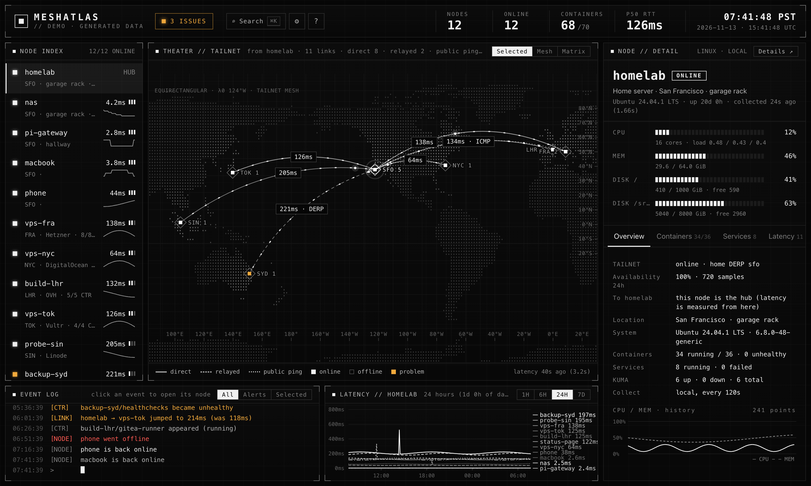
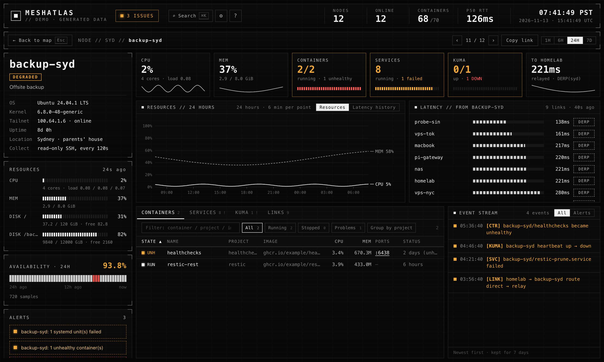
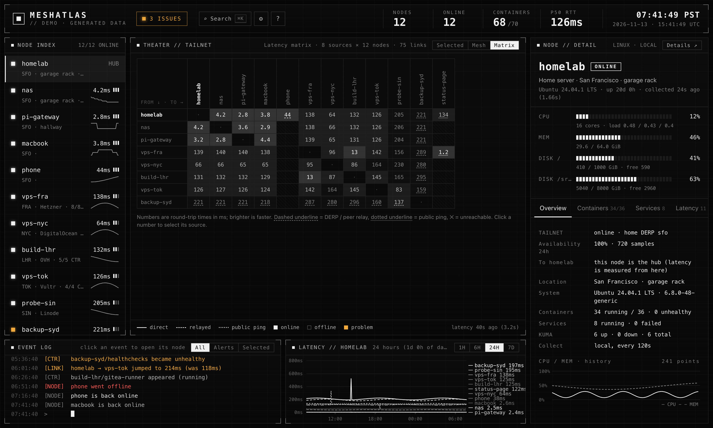
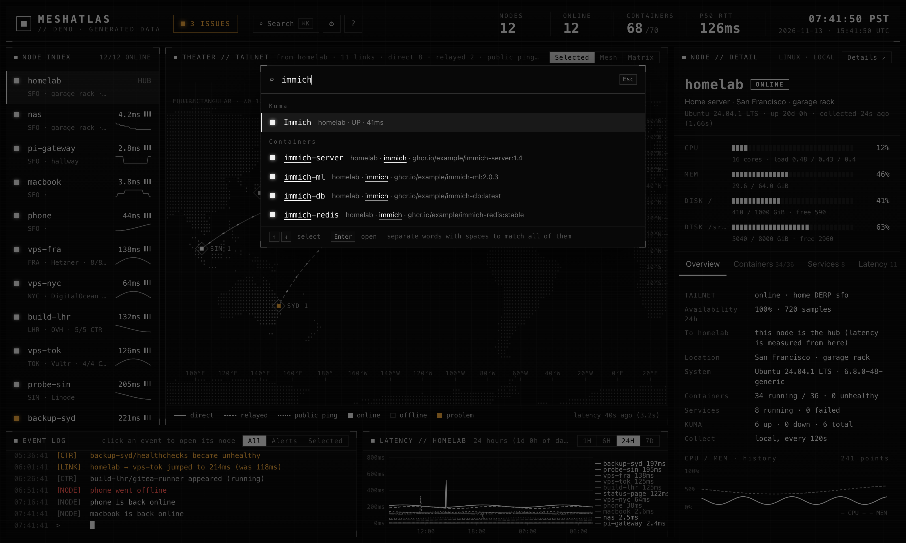

<div align="center">

# MeshAtlas

**A live, HUD-style map of your Tailscale tailnet.**
Where every node is, how it is connected — direct, DERP or peer relay — and what is running on it.

[**Live demo**](https://lij768423-svg.github.io/meshatlas/) · [Quick start](#quick-start) · [Configuration](#configuration) · [中文说明](README.zh-CN.md)



</div>

---

The Tailscale admin console tells you which machines exist. MeshAtlas shows you **the network between them**:
a world map with every node placed by its nearest DERP region, links drawn as direct or relayed paths with real
round-trip times, a full latency matrix, and — if you give it read-only SSH — the containers, systemd units, CPU,
memory and disks of each host. It is one Python process with **zero dependencies**, and nothing ever leaves your tailnet.

## Highlights

- **Zero config.** Run it on any machine in your tailnet. Nodes come from `tailscale status`, locations from the DERP
  map, latency from `tailscale ping`. Add a config file only when you want more.
- **Paths, not just pings.** Every link shows whether WireGuard went direct, through a DERP region or through a
  peer relay, and the event log tells you when that changes.
- **Full mesh.** Nodes you can SSH into ping all the others, giving a complete N×N latency matrix.
- **What runs where.** Read-only collection over SSH: `docker ps`/`docker stats`, `systemctl list-units`, `/proc`.
  No agent to install, no secrets read (no `docker inspect`, no environment variables).
- **Detail pages** for every node: CPU / memory history, availability, per-link stats (P95, jitter), a sortable
  container table, services, Uptime Kuma monitors and an event stream.
- **Built for daily use.** ⌘K search across nodes, containers and services, an issues list, browser notifications,
  deep links, keyboard shortcuts, English and 中文, works on a phone.
- **Not only the tailnet.** Watch public servers with ICMP ping from the hub or from any SSH node.
- **Small and boring to run.** Python 3.9+, standard library only on 3.11+, SQLite history (7 days), no build step, no Node,
  no database server. Typically 30–60 MB of RAM.

| | | |
|---|---|---|
|  |  |  |

## Quick start

```bash
# try it without a tailnet: the UI with generated data
uvx meshatlas demo            # then open http://127.0.0.1:8765

# on any machine in your tailnet
uvx meshatlas                 # or: pipx install meshatlas && meshatlas
```

MeshAtlas listens on this machine's Tailscale IP (port 8765), so the page is reachable from every device in the
tailnet and from nowhere else. Run `meshatlas check` if something looks off.

### Docker

```bash
docker run -d --name meshatlas --network host --restart unless-stopped \
  -v /var/run/tailscale/tailscaled.sock:/var/run/tailscale/tailscaled.sock \
  -v meshatlas-data:/data \
  ghcr.io/lij768423-svg/meshatlas run --host auto
```

or use [`docker-compose.yml`](docker-compose.yml). The container uses the host's `tailscaled` through its socket;
it does not join the tailnet itself.

### systemd

`pipx install meshatlas`, then copy [`examples/meshatlas.service`](examples/meshatlas.service) to
`~/.config/systemd/user/` and `systemctl --user enable --now meshatlas`.

## Configuration

Everything is optional. `meshatlas init` writes a commented `meshatlas.toml` that lists the nodes it found.
MeshAtlas looks for `./meshatlas.toml`, `~/.config/meshatlas/meshatlas.toml` and `/etc/meshatlas/meshatlas.toml`
(or `-c path`). JSON works too.

```toml
[locations.home]                 # your own places
name = "Home"
lat = 37.77
lon = -122.42

[nodes.nas]                      # key = MagicDNS name of the node
location = "home"                # a [locations] key or a DERP code such as "fra"
role = "NAS"
ssh = "admin@nas"                # turn on read-only collection over SSH
notes = ["Scrub runs on the 1st"]

[[external]]                     # a server outside the tailnet, watched with ICMP
id = "status-page"
address = "203.0.113.10"
location = "fra"
probe_from = ["hub", "nas"]

[kuma]                           # optional: an Uptime Kuma public status page
url = "http://100.64.0.1:3001"
slug = "default"
```

See [`examples/meshatlas.example.toml`](examples/meshatlas.example.toml) for every option. Display preferences
(hidden nodes, sort order, map labels, top-bar metrics, language…) are set in the page itself and stored per browser.

## How it works

| What | Where it comes from |
|---|---|
| Nodes, online state, OS, tags | `tailscale status --json` on the machine running MeshAtlas (the *hub*) |
| Location | your config, else the node's home DERP region (`tailscale debug derp-map`); a hub on a custom DERP region uses the nearest official one from `tailscale netcheck` |
| Latency and path | `tailscale ping` from the hub to every online peer; with `mesh = true`, also from every SSH node |
| Containers, units, CPU, memory, disks | a read-only Python script piped to `python3 -` over SSH (nothing is written to the remote disk) |
| Public servers | `ping` from the hub or an SSH node |
| History | SQLite in `~/.local/state/meshatlas` (or `MESHATLAS_DATA`), kept for 7 days |

The exact remote commands are in [`remote_collect.py`](src/meshatlas/remote_collect.py) and
[`tailscale.py`](src/meshatlas/tailscale.py). See [SECURITY.md](SECURITY.md) for the security model.

## Security in one paragraph

MeshAtlas only reads. It binds to the Tailscale IP by default, so tailnet ACLs decide who can open it; add
`token = "..."` (or `MESHATLAS_TOKEN`) for a shared secret, or put it behind `tailscale serve` for HTTPS. SSH runs
with `BatchMode=yes` using your existing keys and `~/.ssh/config`. The browser never receives SSH targets, and the
remote collector never reads environment variables or container configs.

## FAQ

**My nodes are in the wrong city.** Locations default to each node's *nearest DERP region*, which is a guess.
Set `location` for the node (a DERP code such as `"fra"` or your own `[locations.x]`).

**Does it work with Headscale?** It uses only the `tailscale` CLI on the hub, so it should; DERP coordinates come
from whatever DERP map your control server hands out. Reports welcome.

**Why not an agent?** SSH is already there, already secured, and already audited. MeshAtlas runs a short read-only
script and leaves nothing behind.

## Development

```bash
git clone https://github.com/lij768423-svg/meshatlas && cd meshatlas
python -m pip install -e '.[dev]'
pytest && ruff check src tests
meshatlas demo        # UI with generated data; edit files in src/meshatlas/web and reload
```

The front end is plain JavaScript (D3 for the map) with no build step. See [CONTRIBUTING.md](CONTRIBUTING.md).

## Friendly links

- [LINUX DO — 新的理想型社区](https://linux.do)

## License

MIT. Bundled D3, topojson-client and world-atlas data are ISC licensed — see [NOTICE.md](NOTICE.md).
MeshAtlas is not affiliated with Tailscale Inc.
