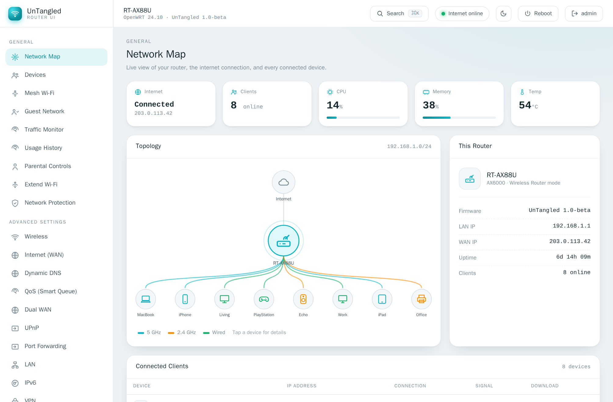
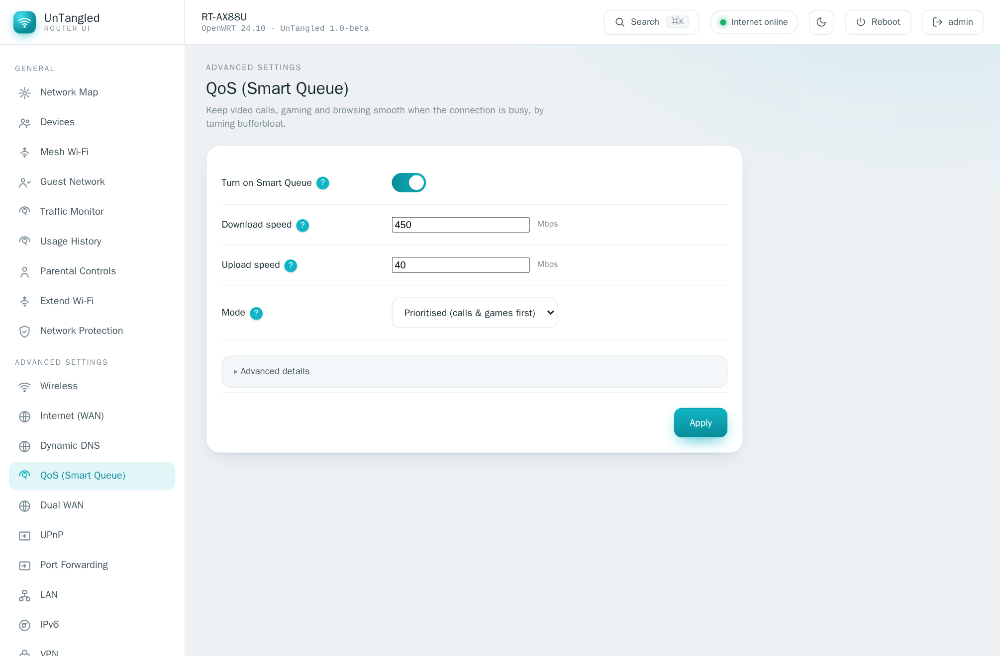
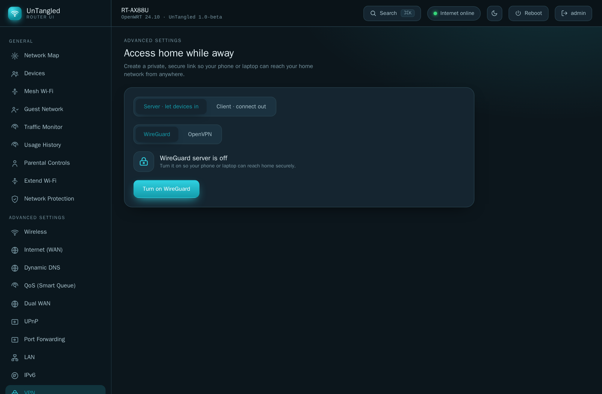
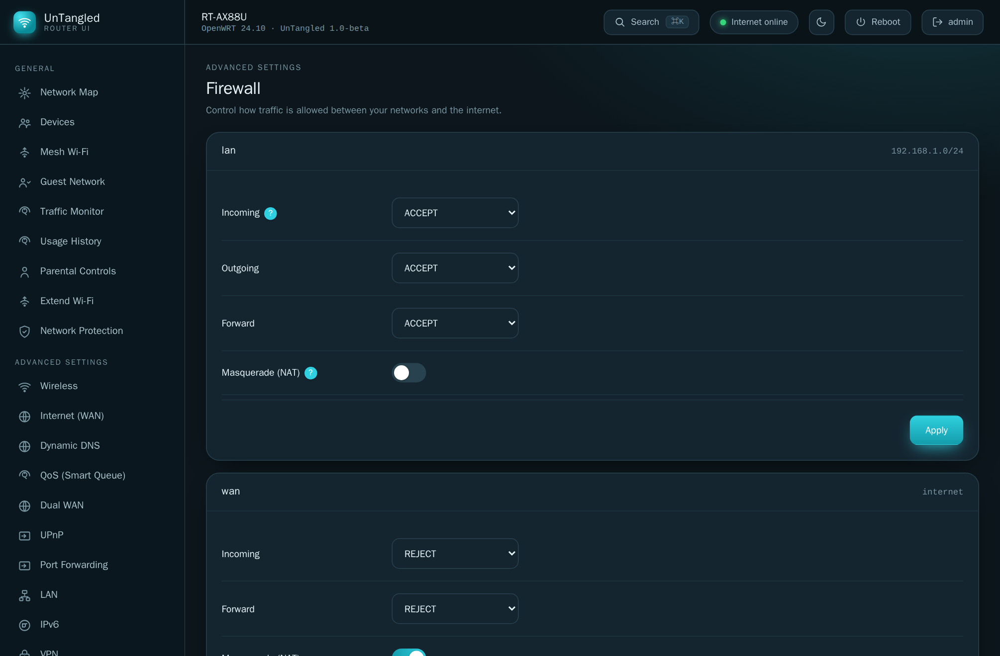
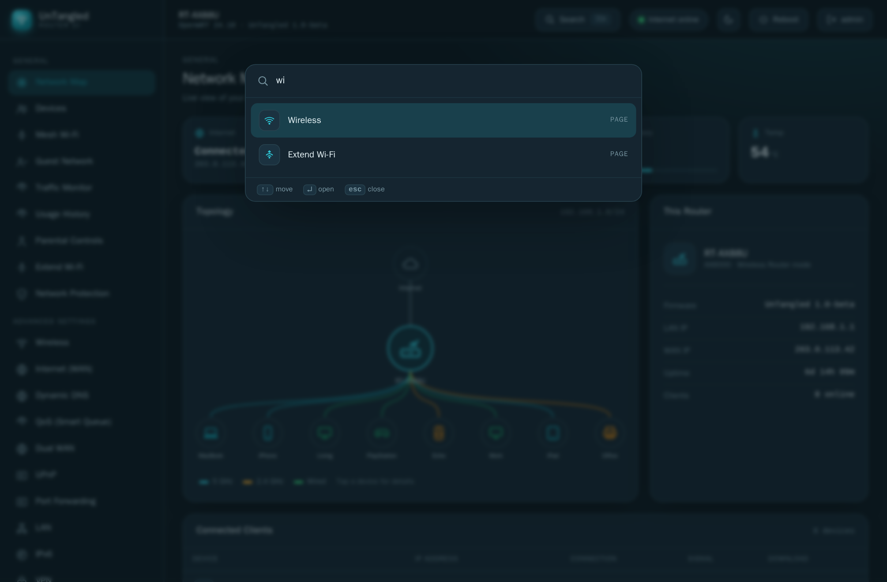

<div align="center">

<a href="https://bidhata.github.io/untangled/"><picture><source media="(prefers-color-scheme: dark)" srcset="site/logo-dark.svg"></picture></a>

### Your router, untangled.

**A modern, friendly web interface for OpenWRT.** All the power of LuCI, without the maze.<br>
Built for the whole household, with every advanced knob still one click away.

[](https://bidhata.github.io/untangled/)
[](https://bidhata.github.io/untangled/demo/)


<a href="https://bidhata.github.io/untangled/demo/"></a>

</div>

---

OpenWRT is the best router firmware there is, but its stock interface was built for engineers. UnTangled keeps all of that power and makes it feel like a product: a visual Network Map, plain-language controls, and a `?` beside every setting for the family, plus a ⌘K command palette and "Advanced details" for you. It runs alongside LuCI and never replaces it.

## Install (step by step)

You'll run a few commands **on the router**, either over SSH or in **LuCI → System → Custom Commands** (no SSH needed). It takes about a minute, and LuCI keeps working untouched the whole time.

**Step 1. Which OpenWRT do you have?** In LuCI it's on the **Status → Overview** page (or run `cat /etc/openwrt_release`). If it shows a numbered release like **23.05**, **24.10** or **25.12**, you're on *stable*, so use the **opkg** commands. If it says *SNAPSHOT*, use the **apk** commands. (When in doubt, you're almost certainly on stable.)

**Step 2. Add the UnTangled feed and install.** Copy–paste the matching block:

<details open>
<summary><b>Stable OpenWRT (23.05 / 24.10) — opkg</b></summary>

```sh
# 1. Trust UnTangled's signing key (so the router knows the packages are genuine)
wget -O /tmp/untangled.pub https://bidhata.github.io/untangled/keys/untangled.pub
opkg-key add /tmp/untangled.pub

# 2. Add the feed
echo 'src/gz untangled https://bidhata.github.io/untangled/stable' >> /etc/opkg/customfeeds.conf

# 3. Refresh the package list and install (untangled-full = everything)
opkg update
opkg install untangled-full
```
</details>

<details>
<summary><b>OpenWRT snapshot — apk</b></summary>

```sh
# 1. Trust UnTangled's signing key
wget -O /etc/apk/keys/untangled.pem https://bidhata.github.io/untangled/keys/untangled.pem

# 2. Add the feed
echo 'https://bidhata.github.io/untangled/snapshot/packages.adb' > /etc/apk/repositories.d/untangled.list

# 3. Refresh and install (untangled-full = everything)
apk update
apk add untangled-full
```
</details>

**Step 3 — Open it.** Go to **`http://<router-ip>/untangled/`** in your browser (e.g. `http://192.168.1.1/untangled/`) and sign in with your **router's admin account** — the same username/password you use for LuCI. That's it. LuCI still works untouched at `/`.

> **No router yet?** [Click through the live demo](https://bidhata.github.io/untangled/demo/) first — the full UI with sample data, right in your browser.

| Package | What you get |
|---|---|
| `untangled` | Core UI + `/ubus` + session auth. HTTP-only, minimal. |
| `untangled-full` | Core **+** HTTPS by default, Wi-Fi scan, firmware upgrade, Wake-on-LAN. |
| `untangled-mesh` | Mesh Wi-Fi backend (dawn roaming + umdns discovery). |

> **Which one? Just install `untangled-full`.** It gives you everything.
>
> **Why is the `untangled-full` download tiny (~1 KB) and `untangled` ~90 KB?**
> That's expected. `untangled` (core) holds the actual interface, so it's the
> big one. `untangled-full` is just a short "shopping list" that tells the router
> to install the core **plus** the extras (HTTPS, Wi-Fi scan, firmware, WoL), so
> its own file is tiny, but installing it pulls in everything. Think of it like
> a "meal deal" ticket: small ticket, full meal.

Prefer a file? Every release attaches raw `.ipk` (stable) and `.apk` (snapshot) on [Releases](https://github.com/bidhata/untangled/releases). The package is architecture-independent (`PKGARCH:=all`), so one `.ipk` covers every current stable release; apk is used only by OpenWRT snapshot. Post-install ACL notes, size table and HTTPS setup: [`openwrt/README.md`](openwrt/README.md). What a logged-in session is allowed to do on the router (path-scoped rpcd ACL), HTTPS and the signing key: [`docs/SECURITY.md`](docs/SECURITY.md).

**Reading the file names on the Releases page:**

| File | Format | For | Which |
|---|---|---|---|
| `untangled_<ver>_all.ipk` | opkg | **OpenWRT 23.05 / 24.10** (stable) | core |
| `untangled-full_<ver>_all.ipk` | opkg | stable | full (recommended) |
| `untangled-<ver>.apk` | apk | **OpenWRT snapshot** only | core |
| `untangled-full-<ver>.apk` | apk | snapshot only | full |

> On stable OpenWRT use the **`.ipk`** files. The **`.apk`** files are only for the experimental *snapshot* builds. The long names (version plus `all` for "any router model") are required by the router's package manager, so don't rename them.

> **No router handy?** [Click through the live demo](https://bidhata.github.io/untangled/demo/) for the full UI with sample data, in your browser.

### Coming from a Jio AirFiber router?

If you installed OpenWrt on a **Jio IDU (JIDU)** router — any of the AX6000 models (6101, 6201, 6401, 6601, 6701 on MediaTek, or 6111, 6411, 6611, 6811, 6911 on Qualcomm) — UnTangled installs the same way as above. A few things to know:

- Your router is on **OpenWrt 25.12** (stable), so use the **opkg** commands above.
- The default IP after flashing OpenWrt is **`192.168.1.1`** (the stock Jio address was `192.168.31.1`). Open `http://192.168.1.1/untangled/` after installing.
- Sign in with the OpenWrt **root** account (the password you set in LuCI after flashing — this is *not* the old Jio admin password).
- Both hardware families work: **MediaTek MT7986A** (`mt76` Wi-Fi, official OpenWrt) and **Qualcomm IPQ9574** (`ath11k`, community OpenWrt build). The UI package is architecture-independent.
- UnTangled's **Network Map** will correctly show your model name (e.g. "JioRouter AX6000 JIDU6101") and firmware version, and all features (Wireless, Devices, QoS, VPN, etc.) work the same as on any other OpenWrt router.
- If you're running **AdGuard Home** alongside OpenWrt (common on the "small buffers" Qualcomm build), UnTangled's Network Protection screen detects it and links to the AGH dashboard automatically.

See [`docs/HARDWARE_MATRIX.md`](docs/HARDWARE_MATRIX.md) §5 for the full JIDU model reference.

## Requirements & hardware support

UnTangled is an **OpenWRT** interface. It does not run on stock vendor firmware, DD-WRT, pfSense or similar.

**Runs on** any device with **OpenWRT 23.05 or newer** (24.10 and the 25.x
stable line are both fine, as is snapshot), on **any CPU architecture** (the UI
package is `PKGARCH:=all`), with room for its dependencies: `uhttpd`,
`uhttpd-mod-ubus`, `rpcd`, `rpcd-mod-file`, `rpcd-mod-luci`. The UI itself is
~96 KB gzipped and runs in your browser, so it adds little to router RAM.

**You'll want ≈ 8 MB+ of free flash.** On very small devices (the old 4/32 MB class) the base dependencies may not fit. That's a device limitation, not an UnTangled one.

**Features light up when their OpenWRT package is present, and stay out of the way when it isn't.** Each advanced screen degrades to a one-click "install …" card instead of breaking:

| Feature | Needs |
|---|---|
| Wi-Fi scan / signal, HTTPS, firmware upgrade, Wake-on-LAN | `untangled-full` (pulls `rpcd-mod-iwinfo`, `cgi-io`, a TLS stack + `px5g`, `etherwake`) |
| QoS · Dynamic DNS · UPnP · Dual-WAN · USB sharing · Usage history | `sqm-scripts` · `ddns-scripts` · `miniupnpd-nftables` · `mwan3` · `ksmbd`/`minidlna` · `vnstat` + `nlbwmon` |
| Mesh Wi-Fi · Tailscale | `untangled-mesh` · `tailscale` |

> **Beta.** Verified on OpenWRT 23.05 and snapshot container images (install, serving, signed feed), with a field report on the 25.x stable line (JioRouter AX6000 / JIDU6101 on OpenWrt 25.12 — UI + device detection; see [`docs/HARDWARE_MATRIX.md`](docs/HARDWARE_MATRIX.md)). **Not yet validated across physical routers** for roaming/mesh — behaviour that depends on live radios, clients and vendor Wi-Fi drivers may vary by device. Mesh is OpenWRT-to-OpenWRT only and is **not** certified Multi-AP/prplMesh. Please [open an issue](https://github.com/bidhata/untangled/issues) with your model if something looks off.

---

## Why UnTangled?

- **Made for everyone.** Task-based flows and a visual Network Map for non-technical users; full depth, a command palette and "Advanced details" disclosures for the technical ones. One UI, no compromise.
- **Hard to lock yourself out.** Connectivity-risky changes (Wireless, WAN, LAN, Firewall, DMZ) apply with an auto-rollback timer. If a change would cut you off, the router quietly reverts it.
- **Tiny, fast, private.** The whole UI is around 96 KB gzipped, versus LuCI's megabytes. System fonts, no CDNs, no telemetry, no cloud account. The router never needs the internet to serve it.
- **Help where you need it.** A `?` beside each setting explains it in a sentence, so there's no wall of jargon.
- **Mesh Wi-Fi the easy way.** One Wi-Fi name across routers with 802.11r/k/v roaming, set up like a consumer mesh system.
- **Light and dark themes.** A clean light theme by default, a Merlin-style dark theme one click away.
- **Extensible.** A LuCI-style runtime plugin system lets packages add whole screens without rebuilding the core.

## A look around

<table>
  <tr>
    <td width="50%"><br><b>Devices.</b> Reserve a fixed IP, block a device's internet, or wake it on LAN.</td>
    <td width="50%"><br><b>Mesh Wi-Fi.</b> One Wi-Fi name across routers with smooth roaming (a plugin).</td>
  </tr>
  <tr>
    <td width="50%"><br><b>Wireless.</b> SSID, security and channels up front; power, fast-roaming and WMM under Advanced.</td>
    <td width="50%"><br><b>Usage History.</b> Daily and monthly internet use, plus per-device totals.</td>
  </tr>
  <tr>
    <td width="50%"><br><b>Parental Controls.</b> Per-device internet schedules by the week.</td>
    <td width="50%"><br><b>QoS (Smart Queue).</b> Kill bufferbloat and keep calls and gaming smooth.</td>
  </tr>
  <tr>
    <td width="50%"><br><b>VPN.</b> WireGuard and OpenVPN, server <em>and</em> client (dark theme).</td>
    <td width="50%"><br><b>Firewall.</b> Zone policies in plain terms, fw4/nftables under the hood (dark theme).</td>
  </tr>
  <tr>
    <td width="50%"><br><b>⌘K command palette.</b> Jump to any page, device or action in a keystroke.</td>
    <td width="50%"><br><b>Firmware.</b> Upload, verify, and flash a sysupgrade image, keeping your settings.</td>
  </tr>
</table>

**Everything in the box:** Network Map · Devices (fixed IP / block / Wake-on-LAN) · Mesh Wi-Fi · Guest Network · Traffic Monitor · Usage History · Parental Controls · Extend Wi-Fi (repeater) · Network Protection (ad/threat blocking) · Wireless (+ advanced radio tab) · Internet/WAN · Dynamic DNS · QoS / Smart Queue · Dual WAN · UPnP · Port Forwarding · VPN (WireGuard + OpenVPN, server + client) · Tailscale · LAN · IPv6 (server / relay + announced DNS) · Firewall (zones) · DMZ · Administration (hostname, time, password, scheduled reboot, make UnTangled the default page) · System Log · USB Storage (SMB + DLNA) · Firmware (upgrade, backup/restore) · Software (installed packages).

Many advanced features light up only when their OpenWRT package is present and **degrade gracefully**: each shows an "install *package*" hint instead of an error when it isn't.

## UnTangled vs. LuCI

An honest comparison. LuCI is excellent and complete; UnTangled is the friendlier front door. Keep both.

| | UnTangled | LuCI |
|---|---|---|
| Built for non-technical users | ✅ task-based, plain language, per-field help | engineer-oriented |
| Visual Network Map & device cards | ✅ | — |
| Mesh Wi-Fi setup | ✅ guided, consumer-mesh style | manual, per package |
| Lock-out protection on risky changes | ✅ auto-rollback timer | apply-with-rollback (manual) |
| UI size | ✅ ~96 KB gzipped | several MB |
| Feature completeness & maturity | beta, growing fast | ✅ mature, exhaustive |
| Coexist on the same router | ✅ runs at `/untangled/`, never modifies LuCI | |

## How it works

UnTangled is *just the UI*. It reuses the OpenWRT backend you already have (**UCI + ubus + rpcd + uhttpd**), talking JSON-RPC to `/ubus` with the standard `session.login` and rpcd ACLs. Nothing runs as a separate daemon. The router never contacts anything outside your network; the one exception is in your browser: when your WAN address is behind carrier-grade NAT, the Network Map asks a public echo service for your internet-visible address.

```
src/
  lib/        ubus client, per-feature data layers (wireless, firewall, vpn, …)
  components/ Shell, Topbar, Sidebar, CommandPalette, Help, plugin host, …
  screens/    one Svelte component per nav item
public/plugins/  runtime plugins (e.g. Mesh Wi-Fi, Ping) + manifest
openwrt/    packaging: Makefile (3 packages), rpcd ACLs, uci-defaults
site/       the landing site + signed package feed (GitHub Pages)
ui-prototype/    the clickable UX prototype, also the live demo
```

## Develop

```sh
npm install
npm run dev                      # http://localhost:5173
ROUTER=192.168.1.1 npm run dev   # proxy /ubus to a real router for live data
npm run check                    # svelte-check / TypeScript
npm run build                    # -> dist/
```

**Stack:** Svelte 5 + Vite + TypeScript. Architecture, the per-screen data-source map and the plugin contract live in [`docs/ARCHITECTURE.md`](docs/ARCHITECTURE.md) and [`docs/PLUGINS.md`](docs/PLUGINS.md).

**Write a plugin:** a self-contained ES module dropped into `/www/untangled/plugins/` adds a nav entry and screen at runtime (no core rebuild) using a small stable API (`ubus`, `toast`, `navigate`, `getTheme`). See [`docs/PLUGINS.md`](docs/PLUGINS.md) and the examples in [`public/plugins/`](public/plugins/).

**Releases:** every `v*` tag builds `.ipk` (23.05 SDK) and `.apk` (snapshot SDK), signs them, attaches them to a GitHub Release and publishes the feed + this site to GitHub Pages. Maintainer notes on signing keys and one-time repo setup: [`keys/README.md`](keys/README.md).

## Status & roadmap

UnTangled is in **beta**. The code is written to documented OpenWRT UCI/ubus/fw4 interfaces, and every release is installed and exercised in real OpenWRT containers (23.05 and snapshot: install, dependencies, HTTP serving, `/ubus` auth, ACLs, mesh backend) before it ships. On physical hardware it has one field report so far — a JioRouter AX6000 (JIDU6101) on OpenWrt 25.12, UI and device detection confirmed — but it has **not yet been validated across many physical routers**, and that's where you come in. See [`docs/HARDWARE_MATRIX.md`](docs/HARDWARE_MATRIX.md) to add a result.

Next up: hardware validation reports, VPN policy routing (per-device VPN, à la Merlin's VPN Director), and Mesh phase 3 (automatic node discovery, one-click dumb-AP bridging, 802.11s wireless backhaul).

## Help it grow

- **Star the repo.** It's the single best way to help more OpenWRT users find a friendlier UI.
- **Run it on your router** and [open an issue](https://github.com/bidhata/untangled/issues) with what you see: model, OpenWRT version, what worked, what didn't.
- **Build a plugin** for the thing your network needs.
- Tell a friend who's been putting off OpenWRT because of the UI.

## Credits

Developed by **Krish Paul** · <me@krishnendu.com> · Licensed **GPL-2.0-or-later**<br>
Website: <https://bidhata.github.io/untangled/> · Source: <https://github.com/bidhata/untangled>

Thanks to **[@spdixit](https://github.com/spdixit)** for field testing and bug reports
(device band/connection detection, applied-item ordering, installed-app visibility, and
the first physical-hardware report — JioRouter AX6000 / JIDU6101 on OpenWrt 25.12, which
surfaced the stale topbar model/version).

Thanks to **[u/venkatx5](https://www.reddit.com/user/venkatx5/)** for install feedback and bug
reports (device internet blocking and parental controls, Samba4 storage detection, device
renaming, AdGuard Home detection, firewall rule creation, config backup, and package-list
detection for `untangled-full`).

Thanks to **[@jc21](https://github.com/jc21)** for the FriendlyWrt install report
([#2](https://github.com/bidhata/untangled/issues/2)) — `untangled-full` failing on images
that ship OpenSSL/wolfSSL instead of mbedTLS, which fixed the TLS dependencies to use the
virtual providers (`libustream-ssl` / `px5g`) so any installed variant satisfies them.

Thanks to the reporter of the **Firefox-on-iPhone sign-in bug** — being bounced to the login
screen when switching screens — which surfaced that the session token was never persisted;
it is now kept across reloads and tab restores, with a longer, auto-renewed rpcd session.

---

<div align="center">

<sub>Please keep it in mind — I'm just a Spaghetti developer who is having AI agents now to help. I'm just a curious tinker and reverse-engineering addict, who can't resist poking at anything to see what happens. 😄</sub>

</div>
