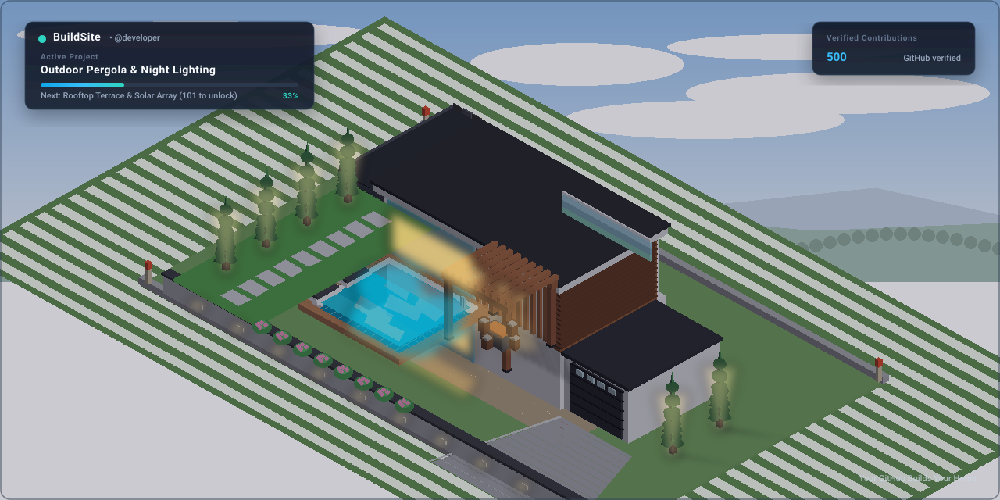

<div align="center">

# 🏡 BuildSite

### **Your GitHub Builds Your Home.**

Transform your verified GitHub contributions into an evolving, photorealistic residential villa that lives directly inside your GitHub profile README.

[](https://github.com/buildsite/buildsite/actions/workflows/ci.yml)
[](LICENSE)
[](pyproject.toml)
[](action.yml)
[](docs/architecture.md)

<br/>

<p align="center">
  
</p>

*A developer's property at 500 contributions: Modern two-storey villa, finished plaster & cedar louvers, swimming pool with azure water, manicured lawn, Italian cypresses, pergola lounge, and evening architectural lighting.*

</div>

---

## 🌟 Why BuildSite?

Most GitHub profile stat cards are dashboards with flat charts, generic badges, or cartoon pixels.

**BuildSite is different**:
- 🏛️ **Photorealistic Architecture**: Modeled in 3D with physically based rendering (PBR), natural stone, cedar timber louvers, floor-to-ceiling glass, polished concrete, and azure swimming pool water.
- 📈 **Real GitHub Progression**: Powered by GitHub's official GraphQL and REST APIs. Every single commit, pull request, issue, and review physically advances your construction site.
- 🎨 **Deterministic Personalization**: Your property is uniquely yours. Seeded deterministically by your stable GitHub ID, your property features personalized material palettes, landscaping flora, and lighting temperatures.
- ⚡ **Zero Hosted Backend & No Paid APIs**: Runs completely free inside a lightweight GitHub Action in under 200 milliseconds. No servers, no AI rendering fees, no external dependencies.
- 📐 **Standards-Compliant SVG**: Self-contained SVG document with embedded high-resolution architectural imagery, crisp native vector HUD typography, progress bars, and declarative CSS animations (with full reduced-motion accessibility support).

---

## 🏗️ The Construction Journey

Watch your property physically evolve as you push code:

| Milestone | Contributions | Architectural Unlocks | Preview |
|---|---|---|---|
| **Empty Plot** | `0` | Surveyed land parcel, perimeter corner pegs, raw soil pad | [View SVG](examples/sample_gallery/stage_0_plot.svg) |
| **Excavation & Foundations** | `1 – 10` | Trenching, steel rebar reinforcement grid, concrete footing slab | [View SVG](examples/sample_gallery/stage_1_foundations.svg) |
| **Building Frame** | `31 – 60` | Suspended first floor slab, second storey framing, cantilever beams | [View SVG](examples/sample_gallery/stage_2_structure.svg) |
| **Roofing & Glazing** | `61 – 100` | Flat roof deck, aluminum mullions, panoramic Low-E double glazing | [View SVG](examples/sample_gallery/stage_3_roofing.svg) |
| **Swimming Pool** | `201 – 300` | Turquoise mosaic pool, teak wood deck, submerged LED lights, loungers | [View SVG](examples/sample_gallery/stage_4_pool.svg) |
| **Gardens & Pergola** | `451 – 600` | Emerald lawn, Italian cypress trees, cedar pergola, dusk spotlights | [View SVG](examples/sample_gallery/stage_5_pergola_garden.svg) |
| **Estate Expansion** | `901 – 1,500`| Modern guest suite pavilion wing, linear reflecting water fountain | [View SVG](examples/sample_gallery/stage_6_guesthouse.svg) |
| **Master Luxury Estate**| `1,501+` | Championship acrylic sports court, extended private olive grove | [View SVG](examples/sample_gallery/stage_7_master_estate.svg) |

---

## 🚀 Quick Start (Install in 2 Minutes)

### 1. Add the Workflow
In your personal GitHub profile repository (`https://github.com/<username>/<username>`), create `.github/workflows/buildsite.yml`:

```yaml
name: BuildSite

on:
  schedule:
    - cron: "0 6 * * *" # Runs daily at 06:00 UTC
  workflow_dispatch:   # Allows manual trigger anytime

permissions:
  contents: write

jobs:
  build:
    name: Evolve Property
    runs-on: ubuntu-latest
    steps:
      - name: Checkout repository
        uses: actions/checkout@v4

      - name: Evolve BuildSite Property
        uses: buildsite/buildsite@v1
        with:
          username: ${{ github.repository_owner }}
          token: ${{ secrets.GITHUB_TOKEN }}
```

### 2. Embed in Your `README.md`
Add this snippet to your profile `README.md`:

```markdown
## 🏡 My GitHub Builds My Home


```

### 3. Run Workflow
Go to the **Actions** tab in your profile repo, select **BuildSite**, and click **Run workflow**. Within seconds, your property will be generated, committed, and displayed on your profile!

---

## ⚙️ Customization (`buildsite.yml`)

You can customize your property's architecture and rendering by creating a `buildsite.yml` in the root of your repository:

```yaml
version: 1

property:
  style: modern       # modern | timber | slate | coastal | auto
  palette: natural
  lighting: dusk      # dusk | daytime | night
  pool: true          # enable swimming pool
  garden: true        # enable garden landscaping
  garage: true        # enable driveway & garage

render:
  animation: subtle   # subtle | none (respects prefers-reduced-motion)
  png_fallback: true  # also exports buildsite.png

progression:
  preserve_unlocks: true # guarantees previous unlocks are never lost
```

---

## 💻 Command-Line Interface (CLI)

BuildSite can also be used as a standalone CLI tool on macOS, Linux, and Windows:

```bash
# Install via pip
pip install buildsite

# Initialize configuration
buildsite init --user your-github-username

# Validate assets and setup
buildsite validate

# Generate your property
buildsite generate --user your-github-username

# Inspect your construction status and unlocked features
buildsite status

# Preview generated SVG in your default browser
buildsite preview

# Run demo with custom contribution count
buildsite demo --count 500
```

---

## 🏛️ Graphics Pipeline & Architecture

BuildSite uses a **two-stage hybrid graphics architecture**:

1. **Stage 1 (Asset Production)**:
   - Full 3D scenes created in Blender 4.x (`blender/scripts/build_scene.py`, `materials.py`).
   - Physically based shaders (PBR): polished structural concrete, Low-E glass, natural stone cladding, cedar timber, and realistic water transmission.
   - High-resolution, transparency-masked layers with consistent 3/4 perspective alignment and lighting angles stored in `assets/`.
2. **Stage 2 (Fast CI Compositor)**:
   - Lightweight, ultra-fast Python + Pillow engine (< 200ms execution time).
   - Dynamic material tinting, ambient dusk lighting pass blending, and self-contained SVG export.
   - Zero runtime 3D ray-tracing overhead on CI runners.

For complete architectural specifications, see [docs/architecture.md](docs/architecture.md).

---

## 🔒 Security & Privacy

- **Minimal Token Scope**: Requires only `contents: write` to commit the generated SVG to your assets folder.
- **Privacy-Preserving**: Only queries aggregate contribution counts and calendar dates; never reads, stores, or leaks repository names, code, or private commit messages.
- **Safe Output Sanitization**: Path traversal and arbitrary code execution are prevented through strict schema validation.
- **Zero External Requests in SVG**: Self-contained base64 data URIs. No third-party image hosts, tracking beacons, external fonts, or JavaScript.

---

## 📚 Documentation

- [Installation & Setup](docs/installation.md)
- [Architecture & Rendering Pipeline](docs/architecture.md)
- [Customization & Configuration](docs/customization.md)
- [Progression & Evolution Rules](docs/progression.md)
- [Contributing 3D Assets](docs/contributing-assets.md)
- [Troubleshooting](docs/troubleshooting.md)

---

## 🤝 Contributing

We welcome contributions of code, Blender models, materials, and documentation! Please read our [Contributing Guide](CONTRIBUTING.md) and [Code of Conduct](CODE_OF_CONDUCT.md).

---

## 📄 License

- **Source Code**: [MIT License](LICENSE)
- **3D Scenes & Rendered Assets**: [Creative Commons Attribution 4.0 International (CC BY 4.0)](LICENSE)
