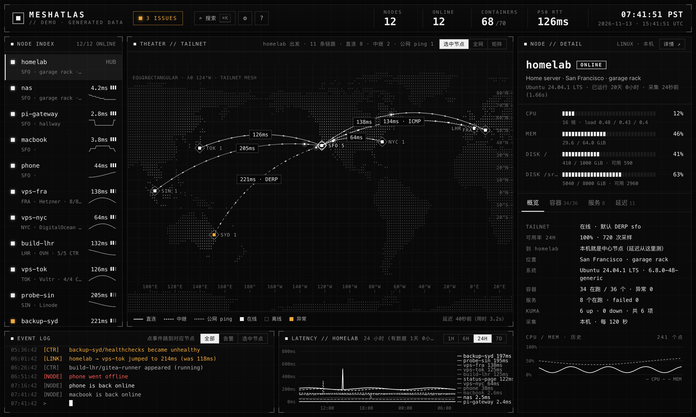
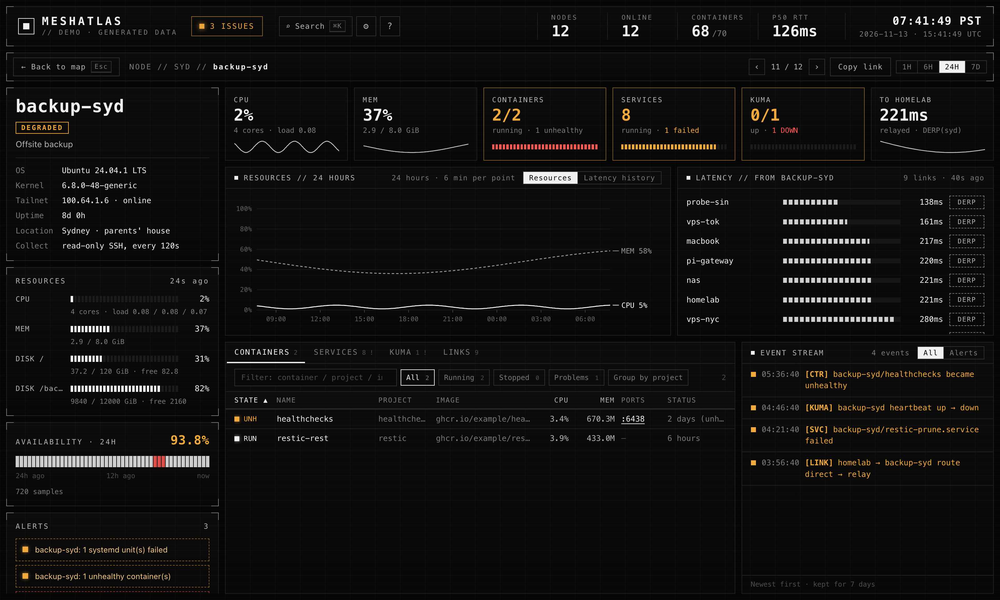
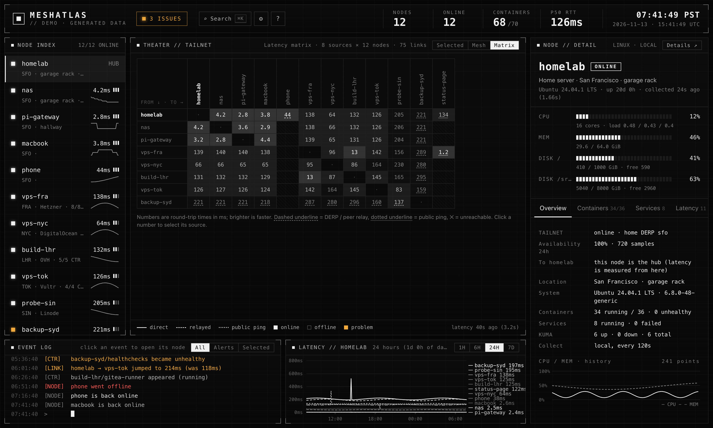
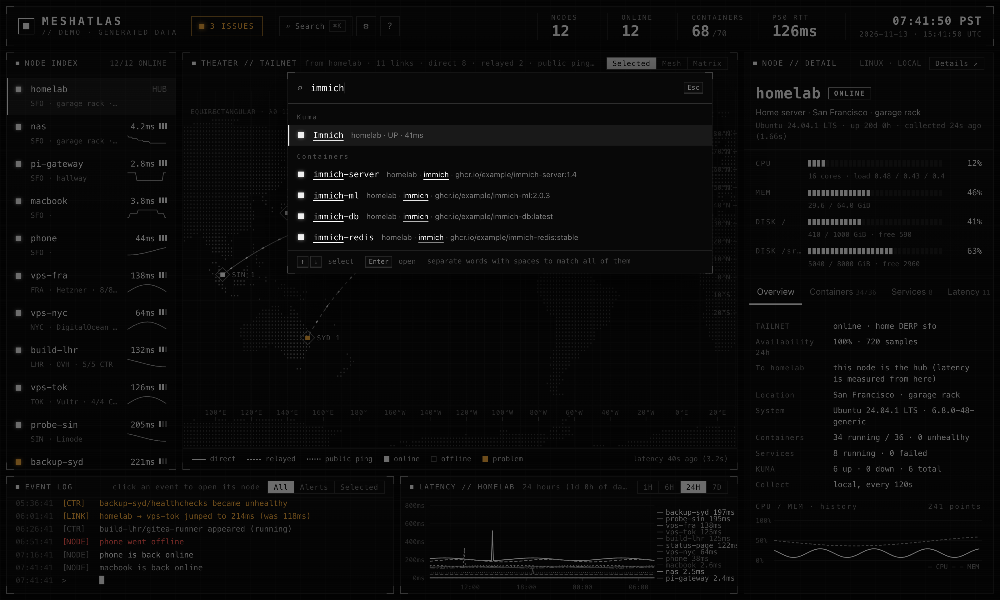

<div align="center">

# MeshAtlas

**你的 Tailscale tailnet 实时地图。**
每台机器在哪、走直连还是 DERP 或 peer relay、上面跑着什么，一屏看完。

[**在线演示**](https://lij768423-svg.github.io/meshatlas/) · [快速开始](#快速开始) · [配置](#配置) · [English](README.md)



</div>

---

Tailscale 管理后台能告诉你有哪些机器。MeshAtlas 让你看到**机器之间的网络**：按最近的 DERP 区域把节点摆在世界地图上，
每条连线标出是直连还是中继、实测往返延迟是多少，还有完整的延迟矩阵；给它只读 SSH 的话，还能看到每台机器的容器、
systemd 服务、CPU、内存和磁盘。它只是一个 Python 进程，**没有任何依赖**，数据不出你的 tailnet。

## 亮点

- **零配置。** 在 tailnet 里任意一台机器上运行即可：节点来自 `tailscale status`，位置来自 DERP 地图，延迟来自
  `tailscale ping`。需要更多功能时再写配置文件。
- **看路径，不只是 ping。** 每条连线都标出 WireGuard 走的是直连、哪个 DERP 区域还是 peer relay，路径变了事件日志会记下来。
- **全网矩阵。** 能 SSH 的节点也会去 ping 其他所有节点，得到完整的 N×N 延迟矩阵。
- **哪台机器上跑着什么。** 通过 SSH 只读采集 `docker ps` / `docker stats`、`systemctl list-units`、`/proc`。
  不用装 agent，也不读敏感信息（不跑 `docker inspect`，不读环境变量）。
- **每台机器都有详情页：** CPU / 内存历史、可用率、每条链路的统计（P95、抖动）、可排序的容器表、服务、
  Uptime Kuma 监控和事件流。
- **日常好用。** ⌘K 搜索节点、容器和服务，异常列表，浏览器通知，可分享的链接，快捷键，中英双语，手机上也能看。
- **不止 tailnet。** 可以从中心节点或任意 SSH 节点用 ICMP 监控公网服务器。
- **轻量省心。** Python 3.9+，3.11 起只用标准库，历史存在 SQLite（7 天），不用构建，不用 Node，不用数据库服务。

| | | |
|---|---|---|
|  |  |  |

## 快速开始

```bash
# 没有 tailnet 也能先看效果：用生成的数据跑界面
uvx meshatlas demo            # 然后打开 http://127.0.0.1:8765

# 在 tailnet 里的任意一台机器上
uvx meshatlas                 # 或者：pipx install meshatlas && meshatlas
```

MeshAtlas 默认监听本机的 Tailscale IP（端口 8765），所以 tailnet 里的设备都能打开，外网打不开。
有问题先跑 `meshatlas check` 自检。

### Docker

```bash
docker run -d --name meshatlas --network host --restart unless-stopped \
  -v /var/run/tailscale/tailscaled.sock:/var/run/tailscale/tailscaled.sock \
  -v meshatlas-data:/data \
  ghcr.io/lij768423-svg/meshatlas run --host auto
```

也可以用 [`docker-compose.yml`](docker-compose.yml)。容器通过 socket 使用宿主机的 `tailscaled`，自己不用登录 Tailscale。

### systemd

`pipx install meshatlas`，再把 [`examples/meshatlas.service`](examples/meshatlas.service) 复制到
`~/.config/systemd/user/`，然后 `systemctl --user enable --now meshatlas`。

## 配置

所有配置项都是可选的。`meshatlas init` 会根据你的 tailnet 生成一份带注释的 `meshatlas.toml`。
程序会依次查找 `./meshatlas.toml`、`~/.config/meshatlas/meshatlas.toml`、`/etc/meshatlas/meshatlas.toml`（也可以 `-c 路径`）。
也支持 JSON。

```toml
[locations.home]                 # 你自己的地点
name = "家"
lat = 30.25
lon = 120.2

[nodes.nas]                      # 键是节点的 MagicDNS 名字
location = "home"                # [locations] 里的键，或者 DERP 区域代码，比如 "tok"
role = "NAS"
ssh = "admin@nas"                # 开启 SSH 只读采集
notes = ["每月 1 号跑 scrub"]

[[external]]                     # 不在 tailnet 里的服务器，用 ICMP 监控
id = "status-page"
address = "203.0.113.10"
location = "fra"
probe_from = ["hub", "nas"]

[kuma]                           # 可选：Uptime Kuma 公开状态页
url = "http://100.64.0.1:3001"
slug = "default"
```

全部选项见 [`examples/meshatlas.example.toml`](examples/meshatlas.example.toml)。显示偏好（隐藏节点、排序、地图标签、
顶栏指标、语言等）在页面的设置里改，存在各自的浏览器里。

## 工作原理

| 内容 | 来源 |
|---|---|
| 节点、在线状态、系统、标签 | 运行 MeshAtlas 的机器（中心节点）上的 `tailscale status --json` |
| 位置 | 配置；没配就用节点最近的 DERP 区域（`tailscale debug derp-map`）。中心节点在自建 DERP 区域时，用 `tailscale netcheck` 找最近的官方区域 |
| 延迟和路径 | 中心节点对每个在线节点跑 `tailscale ping`；`mesh = true` 时 SSH 节点也会跑 |
| 容器、服务、CPU、内存、磁盘 | 一段只读 Python 脚本，通过 SSH 喂给 `python3 -`，远端不落任何文件 |
| 公网服务器 | 从中心节点或 SSH 节点 `ping` |
| 历史 | SQLite，放在 `~/.local/state/meshatlas`（或 `MESHATLAS_DATA`），保留 7 天 |

远端执行的命令全部在 [`remote_collect.py`](src/meshatlas/remote_collect.py) 和 [`tailscale.py`](src/meshatlas/tailscale.py) 里，
安全模型见 [SECURITY.md](SECURITY.md)。

## 常见问题

**节点位置不对。** 默认位置是节点*最近的 DERP 区域*，只是个估计。给节点配上 `location`（DERP 代码如 `"tok"`，或你自己的 `[locations.x]`）就行。

**支持 Headscale 吗？** 中心节点上只用到 `tailscale` 命令行，理论上可以；DERP 坐标来自控制服务器下发的 DERP 地图。欢迎反馈。

**为什么不用 agent？** SSH 本来就有、本来就安全、本来就有审计。MeshAtlas 只跑一段很短的只读脚本，不留任何东西。

## 开发

```bash
git clone https://github.com/lij768423-svg/meshatlas && cd meshatlas
python -m pip install -e '.[dev]'
pytest && ruff check src tests
meshatlas demo        # 用生成的数据跑界面；改 src/meshatlas/web 里的文件后刷新
```

前端是原生 JavaScript（地图用 D3），没有构建步骤。见 [CONTRIBUTING.md](CONTRIBUTING.md)。

## 友情链接

- [LINUX DO - 新的理想型社区](https://linux.do)

## 许可证

MIT。内置的 D3、topojson-client 和 world-atlas 数据是 ISC 许可，见 [NOTICE.md](NOTICE.md)。
MeshAtlas 与 Tailscale Inc. 没有关联。
