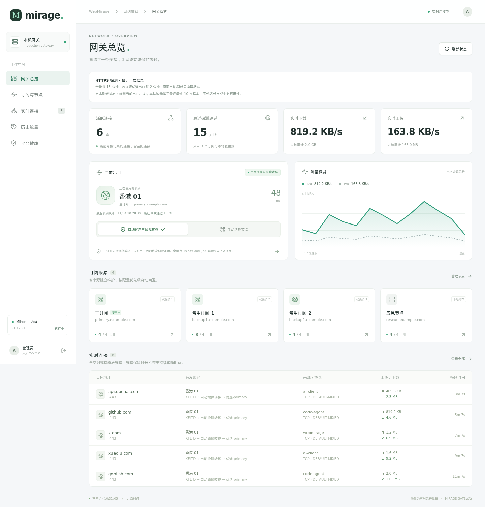
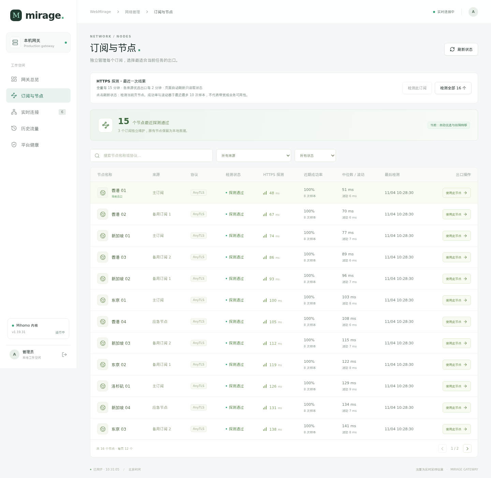
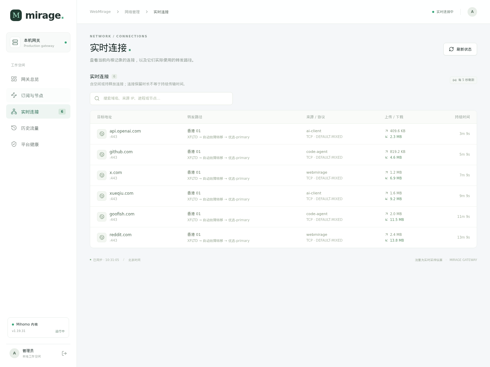
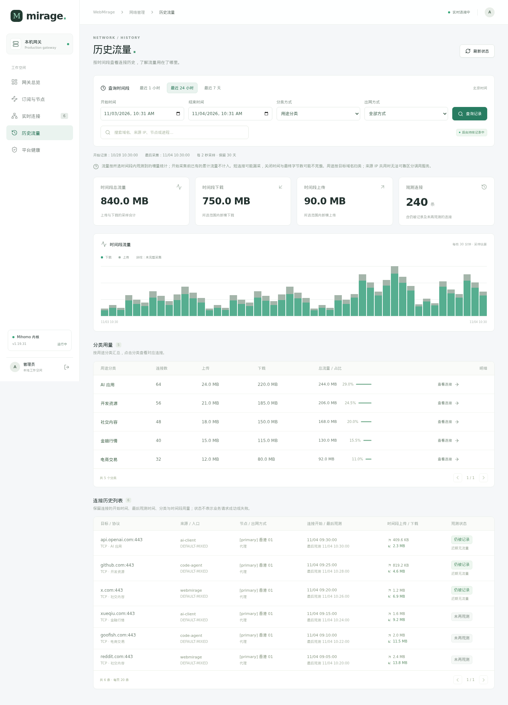
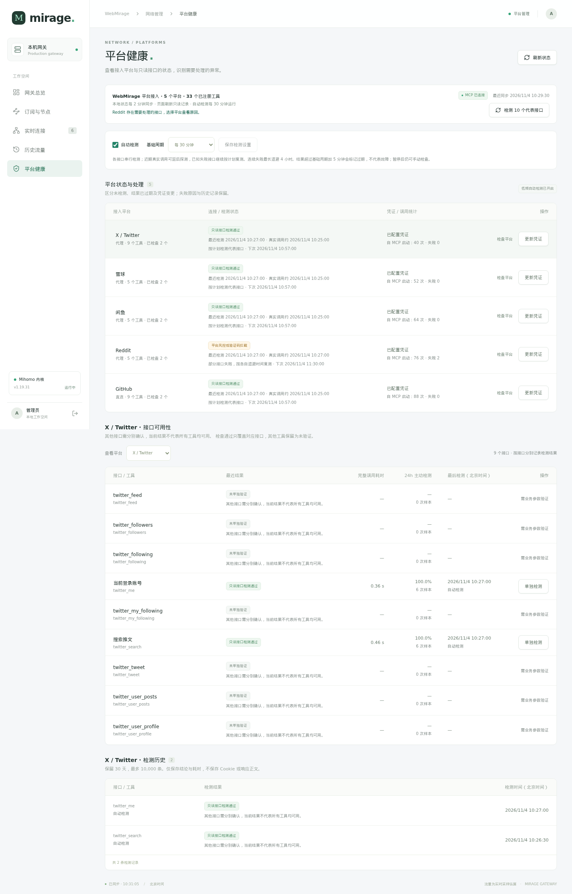

# WebMirage 网关控制台

WebMirage 的独立管理台提供五个页面：网关总览、订阅与节点、实时连接、历史流量和平台健康。页面使用统一的侧边导航、卡片、表格与状态提示；WebMirage 负责管理，Mira 等客户端负责调用 MCP 服务。

下面是当前版本页面截图，使用浏览器内的演示数据展示界面。节点名称、订阅域名、来源 IP、调用次数、流量和检测结果均为示例，不公开实际部署的凭证或使用记录；截图不代表服务当前可用状态。截图过程没有执行真实节点切换、平台探测或配置写入。点击图片可查看原图。

## 1. 网关总览

一页查看当前出口、可用节点、实时上传下载速率、各订阅状态和当前连接。出口控制提供“自动优选与故障转移”和“手动选择节点”：自动模式在各订阅内优选低延迟节点，再按主备顺序故障转移；手动固定后可以恢复自动模式。

## 2. 订阅与节点

按订阅、节点名称和可用状态筛选，查看最近 HTTPS 探测耗时、近期成功率、样本波动和最后检测时间。总览和节点页提供当前出口、当前页、指定订阅或全部节点的手动检查入口，支持搜索、分页及手动出口选择。

延迟是指定 HTTPS 测试目标的探测结果，不等同于下载带宽或所有业务网站的访问速度；旧结果会标记时间。页面轮询仅读取状态；在节点页主动点击“刷新状态”会检测当前页节点，总览页的刷新则检测当前出口。手动检测串行执行并设有冷却，避免重复提交。

## 3. 实时连接

列表显示 Mihomo 当前仍记录的连接，包含目标地址、来源、协议、实际转发路径、上传下载量及持续时间。同一域名可以存在多条连接；列表数量不等于接入平台数量。切换出口后，既有连接可能继续使用原来的节点。

## 4. 历史流量

支持最近 1 小时、24 小时、7 天及自定义时间段。可按用途、目标域名、来源 IP、转发节点、出网方式或接入入口汇总，再查看对应连接明细；记录包含采样流量、观测时间和连接状态。

独立后台采集器每 2 秒读取连接计数，即使浏览器关闭，仍会持续记录。用量按观测到的增量计算，开始采集前的累计计数不回填；短连接、采集间断和连接结束前的最后字节可能无法完整记录。用途按目标域名分类，共享来源 IP 不一定能识别到具体调用服务。

## 5. 平台健康

覆盖 X/Twitter、雪球、闲鱼、Reddit、GitHub，共 33 个平台工具。平台列表展示连接／检测状态、凭证是否齐全、调用计数、最近结果和下次检测计划；下方按接口查看主动检测耗时、成功率与历史。没有安全代表参数的工具保持未验证，写操作不参与主动检测。

自动检测默认启用，基础周期 30 分钟，覆盖 10 个固定只读代表接口；可选 15、30、60、120 分钟或暂停。失败逐步退避，最长 4 小时；网页和其他 MCP 客户端共用 `webmirage_check_health`，检查串行执行，同一接口共用 60 秒冷却。页面读取记录不触发探测。“连接 / 检测状态”只采用统一工具的接口级结果，凭证配置和历史调用统计仅供参考。结果过期表示需要新证据，不直接代表故障。

凭证表单按平台列出字段名，默认只填写值，例如 Reddit 的 `reddit_session` 值、雪球的 `xq_a_token` 值。已有值不回显；受环境变量覆盖的字段禁止从页面更新。保存后需要重新检测，不能仅凭保存成功判为健康。

## 部署与数据

| 项目 | 当前方式 |
|------|----------|
| 前端 | Vue 3、TypeScript、Vite，构建后由管理后端提供静态资源 |
| 后端 | Python FastAPI，登录后的 `/api/` 接口 |
| 入口 | 独立管理服务，默认端口 `8091`，使用已配置的本机私网地址 |
| 连接与流量历史 | `gateway/data/history.sqlite3`；默认保留 30 天，数据库使用量超过约 256 MB 时逐步清理较早记录 |
| MCP 检测原始记录 | 配置目录的 `health-checks.sqlite3`，默认保留 30 天、最多 10,000 条；网页通过 MCP 同步并按记录 ID 去重 |
| 平台检测与计划 | `gateway/data/platforms.sqlite3`；检测历史保留 30 天、最多 10,000 条，自动检测设置及复测计划重启后保留 |
| 凭证和密码 | 保存在本地配置和独立密码文件中，已有凭证不会回显到前端 |

管理台独立于 Mira。运行数据库、平台配置、订阅与密钥文件均由 Git 忽略。完整安装步骤、访问方式和检测策略见 [README 的部署说明](../README.md#vue-网关控制台)。

[返回 README](../README.md#网关控制台--最新更新)
