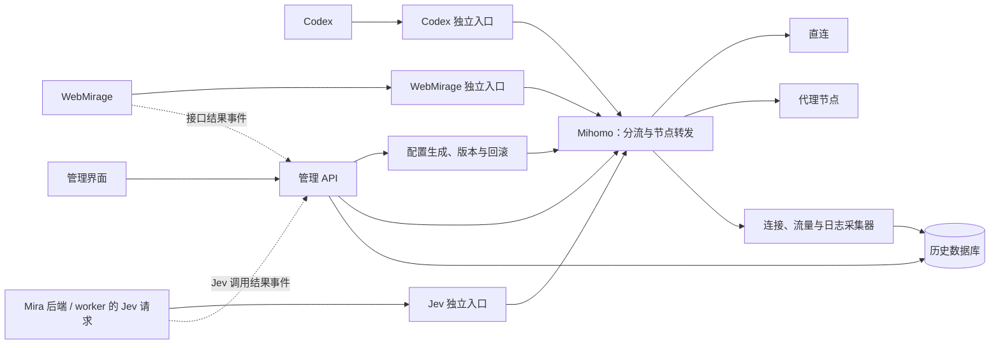

# 统一出网网关管理平台方案

2026-11-02 自动策略：自动与手动两种模式。自动模式在主订阅内通过 URLTest 优选低延迟节点，整组不可用才依次切换备用订阅、本地救援；主订阅恢复后回切。每个来源独立优选，外层 Fallback 保持来源优先级。全量检查周期 15 分钟、各来源当前优选出口每 2 分钟检查，超时 20 秒，切换容差 30ms，策略切换不主动中断旧连接。

2026-11-02 检测优化：页面自动刷新只读取状态，主动刷新按当前出口或当前页限范围检测，也可检测单订阅或全部；手动任务并发 4、完成后冷却 60 秒、显示进度，避免重复探测。节点列表展示最近检测时间、最多 10 次样本的成功率、中位延迟和极差，并标注旧结果。内核仍保留故障触发检查，确保自动模式有恢复能力。


2026-11-02 连通性修复：节点 DNS 按订阅来源的实际服务器域名分别生成策略，避免备用来源的专用 DNS 导致其他来源解析为空；节点与分组健康检测上限统一为 20 秒，周期后续降为全量 15 分钟、优选出口 2 分钟。发布期间保留可用出口，完成检测后恢复原模式，失败回滚。真实超时节点仍保留为异常。


2026-11-02 实施补充：已新增历史流量页、SQLite 持久化采集、时间段用量、用途/域名/来源/节点/出网方式/入口分类及分页连接列表；每 2 秒采样，默认保留 30 天。首次观测和采集恢复均重新建基线，缺口显式展示，不追溯补算此前字节。用途分类基于目标域名，不替代调用方服务身份。独立服务入口、完整业务接口诊断及精确计费日志仍未实现。


日期：2026-10-21。状态：供评审；本文不代表已迁移或上线。

2026-10-30 实施补充：多订阅原生故障转移已落地，独立管理三个订阅及原有本地救援节点；初始实现每 30 秒进行 HTTPS 检测（后续已降低频率）、每小时自动更新订阅。Vue 基础控制台已实现并验证，提供登录、网关总览、订阅节点列表、实时连接和自动／手动出口切换。按用户要求，控制台容器已停止并移除，对外 8091 端口发布已撤销；代码保留为显式启用的 `docker-compose.gateway.yml`，未来启用时默认仅监听回环地址。默认自动回退，手动固定时明确暂停自动回退并可一键恢复；模式和手动节点由内核持久化。已验证故障切换、缓存冷启动、手动选择重启保留，以及桌面和手机浏览器操作。实现入口为 `mihomo/configure_failover.py` 和 `gateway/`；本文中的统一服务入口、历史日志数据库等能力仍为方案，尚未实现。

## 1. 目标与范围

2026-10-31 访问方式调整：Vue 控制台现在复用已可访问的 Mira 入口 `http://192.168.188.3:8086/gateway/`。
仅增加 Mira 的应用页面和 API 路径，管理接口仅在内部网桥地址运行；本次没有修改防火墙、
端口映射、容器网络或 Mihomo 配置。原 `/#projects` 页面和健康检查保持不变。

建立一个独立于 WebMirage 的出网管理平台，统一登记服务、生成接入配置、控制出网策略、查询连接与流量历史、维护订阅及节点。

Mihomo 继续承担实际代理转发与规则执行；管理平台负责配置、观测、操作和历史记录。管理后台暂时故障不应中断已经运行的代理。

第一版管理当前单台主机上的 Codex、WebMirage、Mira/Jev，预留其他主机接入的字段，但不引入多主机控制集群。平台统一的是服务身份和出网政策，各程序仍需按自身能力配置环境变量或 SDK 代理。

HTTPS 保持原有端到端加密。网关记录目标域名/IP、端口、节点、连接时间和字节数；请求路径、HTTP 状态、业务错误通过应用接入提供。网络连接数不等于 API 请求数。

## 2. 当前接入分析

以下来自本机运行配置和代码检查，不只依据历史连接。

| 服务 | 当前接入方式 | 范围 | 迁移注意事项 |
|---|---|---|---|
| Codex，多个进程 | `HTTP_PROXY`、`HTTPS_PROXY`、`ALL_PROXY` 指向 `http://127.0.0.1:7890` | 使用这些设置的外部请求 | 需要修改实际启动环境；已启动的进程一般需要重新启动以读取环境变量 |
| WebMirage 容器 | 大小写 HTTP(S) 代理变量指向 `http://mihomo:7890` | 多个平台的外部请求 | 修改 Compose；保留内网绕过，统一处理 GitHub 直连规则 |
| WebMirage Twitter | 另有 `TWITTER_PROXY` | Twitter 客户端专用请求 | 必须与容器通用代理一起迁移，避免两套出口 |
| Mira/Jev | `MIRA_JEV_PROXY_URL=http://127.0.0.1:7890` | TypeSafe Jev API 请求 | 当前后端和 worker 进程均有此配置；只迁移 Jev 请求，不给整个 Mira 注入全局代理 |
| 未登记客户端 | 可能手工使用宿主机代理端口 | 需要继续发现 | 发现记录只标为“待确认”，不靠来源 IP 自动认领服务 |

现有共享入口导致 Codex 与 Jev 的流量难以稳定区分，Docker NAT 后的来源 IP 也不适合当服务身份。

其他现状：

- Mihomo 当前版本为 v1.19.31，由 WebMirage 仓库的 Compose 管理。
- 宿主机发布了 7890、7891；控制器 9090 仅绑定本机，容器内通过私有网络访问。
- WebMirage 的 `NO_PROXY` 包含 GitHub，相关直连流量绕开网关，当前网关无法记录这部分流量。
- 当前订阅更新器主要保留订阅中的分组和规则；如果直接增加服务配置，下一次订阅更新可能覆盖这些配置。
- WebMirage 的健康状态主要是进程内的平台级历史统计，不足以提供接口级监控。
- WebMirage 目前记录完整工具参数；实施日志接入前应屏蔽 Cookie、Token 等敏感参数。

## 3. 架构与部署



建议技术组成：FastAPI 后端、React/TypeScript 前端、独立采集任务、SQLite WAL 数据库。前端与 API 同源部署；后台通过 SSE 推送界面更新。单机第一版不依赖 Redis、Elasticsearch 或额外时序数据库；数据量增长后再迁移存储。

采集任务由独立进程执行，避免 Web 服务多 worker 重复采集。Mihomo 与平台分成独立服务：平台重启不重启 Mihomo；Mihomo 不再依赖 WebMirage 的生命周期。

后台仅在本机或既有私网/VPN 可达范围提供，带登录会话；浏览器不持有 Mihomo 控制器密钥。后台管理配置目录和控制器，不默认挂载 Docker socket。必须操作宿主机服务时使用范围固定的配置适配器。

## 4. 统一接入与服务管理

### 4.1 接入规范

每个逻辑服务对应稳定的 `service_id`、独立命名的 listener、入口端口和独立策略组。实例单独登记：Codex 的多个进程可归为同一逻辑服务，Mira 后端和 worker 归为 Jev 的两个实例。

初始端口分配建议如下，落地前检查冲突：

| 服务 ID | 入站名 | 宿主机入口 | Docker 网络入口 | 默认策略组 |
|---|---|---|---|---|
| `codex` | `in-codex` | `127.0.0.1:7901` | 按需开放 | `svc-codex` |
| `webmirage` | `in-webmirage` | 按需开放 | `egress-gateway:7902` | `svc-webmirage` |
| `mira-jev` | `in-mira-jev` | `127.0.0.1:7903` | 按需开放 | `svc-mira-jev` |

统一使用 HTTP 代理 URL，混合入口保留 SOCKS 兼容能力。网关容器加入固定的共享出网网络，WebMirage 加入同一网络后使用稳定别名 `egress-gateway`；宿主机使用回环地址。端口不无条件向整个局域网发布。

为服务生成独立代理凭证，客户端兼容性在接入测试中验证。listener 身份用于归属，凭证和网络访问范围用于限制访问；不能把端口号当成身份认证。第一版不依赖进程名或 NAT 来源 IP 归属。

Mihomo 官方文档提供独立 mixed listener、用户认证以及按入站名称/端口/用户匹配规则的能力。本轮已确认当前 v1.19.31 的连接元数据包含 `inboundName`、`inboundPort`、`inboundUser`，可以作为归属采集的基础；实施前仍需对独立入口生成配置、认证和规则命中做端到端兼容性验证。验证不通过时先调整方案或内核版本，不把新文档能力直接当成当前版本已验证能力。

### 4.2 配置每个服务

新增服务时填写：名称、部署位置、实例、代理范围、默认策略、允许直连的目标和健康检查方式。后台生成一份对应配置：

- Codex：启动环境配置片段或启动包装脚本，统一大小写代理变量及 `NO_PROXY`，指向 Codex 专属入口。
- WebMirage：Compose override，统一 HTTP(S) 代理和 `TWITTER_PROXY`，指向 WebMirage 专属入口。
- Jev：仅生成 `MIRA_JEV_PROXY_URL` 配置，分别给 Mira 后端和 worker 生效。

后台展示“配置已生成 → 待应用 → 已连接 → 验证通过”的接入过程。服务已登记但没有连接，只能显示“未观测到流量”，不能判定离线。

第一版提供配置导出与应用后的验证。迁移现有服务时明确找到实际配置来源，避免只修改进程环境的副本。后续才为确认过的 Compose/systemd/启动器增加受限的自动应用适配器；界面明确哪些变更要重启服务。

### 4.3 直连、代理与禁用

为统一观测，把 GitHub 等外部直连目标从客户端 `NO_PROXY` 迁入网关的 DIRECT 规则；本机、容器内部通信继续绕过，避免破坏内部服务发现。所有需要统计的外部访问都先进入网关，再由网关决定直连或代理。

规则优先级为：服务禁用及禁止目标 → 必要的内部直连 → 服务级目标域名覆盖 → 服务默认策略 → 兼容旧入口的默认规则。显式覆盖放在对应默认规则之前，不能让宽泛的入站规则提前吞掉例外。

服务管理支持：

- 固定节点、自动择速、故障转移、网关直连。
- 按服务配置目标域名覆盖，例如 Jev 与 Codex 选不同节点。
- 暂停服务的网关访问：拒绝新连接，并可关闭该服务已有连接。
- 显示策略改变后新旧连接的实际节点；默认不强制中断现有长连接。

“暂停网关访问”只约束经过网关的流量。应用仍能自行直连时，不代表已停止该进程的一切网络访问。需要强制出网管控的容器，可在后续单独使用受限网络和防火墙；第一版按显式代理接入，不宣称已经实现网络隔离。

## 5. 日志监控与流量记录

### 5.1 三类记录

| 类别 | 内容 | 数据来源 |
|---|---|---|
| 连接与流量记录 | 服务、实例（可识别时）、连接 ID、目标、策略、实际节点、开始时间、最后观测时间、上传/下载字节 | Mihomo connections、traffic 数据 |
| 运行异常日志 | DNS、握手、拨号、超时、节点检测失败、采集断连 | Mihomo 日志流及平台自身日志 |
| 管理操作记录 | 谁在何时切换节点、改规则、更新订阅、禁用服务、发布/回滚配置 | 平台操作审计 |

记录实际转发链路，不只记录策略组当前选择；同一策略切换后，旧连接可能仍在原节点。

HTTPS 连接不解密，因此普通代理不能提供 Jev、雪球等业务请求的路径和真实 HTTP 状态。应用可选上报标准事件：`service_id`、`operation`、`duration_ms`、`outcome`、`error_type`、`trace_id`；不发送请求内容或凭证。

服务状态分别展示“网络可达”“近期业务结果”“观测是否新鲜”。第三方返回 401 不直接算节点失效；没有业务探针时显示未验证。

### 5.2 采集与准确性

建议连接快照/流量每 1～2 秒采集，日志持续订阅，自动重连。以内核实例标识和连接 ID 去重，用连接累计字节的增量计算吞吐，避免重复累加。内核重启、计数回退、采集丢失都建立明确断点。

连接从快照消失只记录“已结束/关闭原因未知”，不推断成功或失败；短于采样周期的连接可能遗漏，最后字节数也可能低估。第一版界面标注“按采样估算”，不作为精确计费数据。后续若确需完整逐连接事件与精确结算，需单独评估内核事件能力或增加代理侧计量，而非把轮询宣称为完整访问日志。

新方案上线前的历史日志缺乏服务身份，不强行按服务分摊。平台采集器断连期间显示观测缺口，不能把缺数据画成零流量。

### 5.3 查询、保留与告警

- 实时连接：按服务、域名、节点、协议、时长筛选；支持断开指定连接。
- 历史查询：指定服务在某时间访问了什么目标、走哪个节点、产生多少观测流量；支持导出。
- 趋势：按小时/天查看上传下载、并发连接、异常趋势；应用接入后另展示 API 成功率。
- 建议默认保留明细 7 天、分钟聚合 30 天、小时聚合和审计 180 天，均可配置，并设置数据库容量上限与清理任务。
- 告警在后台事件中心展示：持续无法出网、节点组无可用节点、采集断连、订阅更新失败、配置漂移、应用认证异常。按窗口聚合和恢复状态去重；外部通知渠道后续单独配置。

Cookie、Authorization、代理密码、订阅令牌默认脱敏；错误信息先清洗再写库。诊断页面显示字段是否存在、到期状态、最近验证结果，不显示完整密钥。

## 6. 节点、订阅和策略管理

### 6.1 节点与订阅

节点列表展示来源、地区/标签、最近探测时间、延迟、连续失败、允许使用的服务。可停用节点、调整候选池，手工节点与订阅节点分开维护。停用属于平台覆盖配置，订阅更新后仍生效。

订阅是节点来源，不再直接决定平台入口、服务策略和主路由。现有订阅中的复杂依赖先做兼容性梳理，保留必要的节点依赖；迁移后禁止直接将远端完整配置覆盖生产配置。

配置来源拆分为：

```text
订阅节点 + 本地节点
        + 服务登记/独立入口
        + 平台策略/域名覆盖/DNS 设置
        + 节点启停覆盖
        → 生成候选配置 → 校验 → 发布
```

### 6.2 策略建议

每个服务拥有自己的选择组及候选池，即使共享底层节点，也不共用同一个可变的总选择组，避免切 Jev 时影响 Codex。

- Codex、Jev 优先稳定出口：选定主节点，失败时在经过验证的候选池中回退。
- WebMirage 可用自动择速，并允许 Twitter 等目标域名单独覆盖。
- 统一把健康检测地址改为 HTTPS；候选节点兼容性验证后再应用。
- 自动择速显式设置检测间隔和容差；业务可达性检查与普通延迟检测分开显示。
- 不用 Google 检测成功代替 Jev/ChatGPT 可用性。付费或有副作用的业务探针只按已登记的测试方式调用。

每个服务的候选池、主备顺序和失败后动作必须显示清楚；第一版不默认实现轮换出口或每请求负载均衡。

### 6.3 发布、持久化与回滚

平台保存配置期望状态、版本与当前生效版本。所有变更串行发布，订阅更新、手工改规则、MCP 切换节点走同一个控制入口，避免互相覆盖。

发布步骤：生成候选文件 → 语法与引用检查 → `mihomo -t` → 保存上一版 → 通过控制器加载（必要时受控重启）→ 查询实际配置 → 从各入口验证出网及必要的业务探针 → 标记成功。失败自动回退并复测；首次影响业务的迁移按服务逐一执行。

热切换节点也写入期望状态，使下次重启/生成配置不意外恢复旧选择。手工从其他面板修改会产生漂移提示，平台提供显式同步或重新发布，不静默覆盖。WebMirage 当前的代理切换 MCP 工具后续改为调用平台，保持同一个配置来源。

平台异常时保持最后生效配置；独立维护一份已验证的恢复配置和本机恢复命令，防止管理后台成为恢复代理的唯一入口。

## 7. 管理界面与数据组织

建议导航：总览、服务接入、实时连接、历史流量、异常事件、节点与订阅、策略与配置版本。

服务详情页集中展示：入口与接入说明、配置应用状态、实例列表、当前策略、实际节点、实时连接、流量趋势、最近错误、网络探针与应用探针结果。

第一版核心数据：`services`、`service_instances`、`listeners`、`policies`、`providers`、`node_overrides`、`connection_samples/records`、`traffic_rollups`、`events`、`config_revisions`、`audit_events`。高频采样采用批量写入/聚合，不将所有实时快照无限保存。

凭证与订阅地址通过受限密钥文件或加密存储维护，页面配置/API 返回值使用脱敏表示；数据库备份与运行配置同样按含敏感信息的文件管理。

## 8. 实施顺序与验收

| 阶段 | 交付 | 验收要点 |
|---|---|---|
| 1. 只读观测 | 独立后台、现有 Mihomo 接入、实时连接、日志与采集状态 | 不改变现有出口；展示目标和真实链路；采集失联可见 |
| 2. 统一接入 | 服务登记、独立入口、配置生成、Codex/WebMirage/Jev 逐个迁移 | 同一域名由不同服务访问仍能正确归属；Jev 后端与 worker 均迁移；内部通信正常 |
| 3. 策略和节点管理 | 独立服务策略、订阅管理、发布校验、回滚、配置版本 | 切换只影响目标服务；订阅更新保留入口与策略；失败能恢复 |
| 4. 历史和诊断 | 历史流量、趋势、异常分类、WebMirage/Jev 应用事件 | 重启数据保留；采集缺口明确；认证错误与网络错误分开 |

第一版完成标准是：可以在一个界面看到三个服务各自的连接和流量，单独更换出口、暂停其网关访问、查看历史异常，并在订阅更新后保持这些设置。

旧 7890 入口在迁移期间保留，标记为“兼容入口/未分类”，观察是否仍有流量。三个服务分别验证通过且旧入口消费者确认完毕后，再决定关闭或限定旧入口；不能只迁移当前活跃进程而遗漏其启动配置或 worker。

平台接口 Cookie 管理和自动验收属于后续可接入的应用诊断模块；第一版先复用 WebMirage 的凭证更新能力并修复日志脱敏，不把代理网关扩展成所有业务凭证的唯一保管处。

## 9. 本轮产出与待验证项

本轮仅新增方案文件，未修改代理、应用配置或容器部署。

实施开始时优先验证：v1.19.31 的独立 listener 与连接归属字段、各客户端代理认证兼容性、当前部署配置来源与重启方式、旧入口实际消费者、订阅节点依赖、SQLite 采集与保留策略的容量表现。

## 参考

- [Mihomo mixed listener：入口与认证](https://wiki.metacubex.one/config/inbound/listeners/mixed/)
- [Mihomo 路由规则：IN-NAME、IN-PORT、IN-USER](https://wiki.metacubex.one/config/rules/)
- [Mihomo 控制 API：日志、流量、连接、策略与配置](https://wiki.metacubex.one/api/)

在线文档用于核对能力边界，当前内核的可用性以实施前兼容性验证为准。
